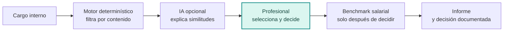

<div align="center">

<picture>
  <source media="(prefers-color-scheme: dark)" srcset="branding/banners/espejo-banner-oscuro.svg" />
  
</picture>

# Espejo · Homologa

**Una comparación concreta hoy. Nuevas oportunidades para el talento mañana.**

[](docs/general/01-proposito-y-alcance.md) [](package.json) [](package.json) [](https://github.com/NicoCG32/Espejo-Homologa/actions/workflows/calidad.yml)

[Documentación](docs/README.md) · [Cómo funciona](docs/general/02-recorrido-del-analista.md) · [Visión de plataforma](docs/general/04-vision-de-plataforma.md) · [El pitch](docs/formativa/02-pitch-y-vision.md) · [Investigación económica](docs/desarrollo/05-evidencia-externa-y-escenarios.md) · [Mercado y competencia](docs/desarrollo/07-estudio-de-mercado-y-posicionamiento.md) · [Colaboración](docs/formativa/03-colaboracion-y-atribucion.md)

</div>

## Resumen ejecutivo

**Espejo · Homologa** es un piloto web de origen **colaborativo e intergeneracional** que compara cargos internos con referencias de encuestas salariales. Un **motor determinístico** filtra candidatos con reglas ponderadas; la **IA semántica, cuando se solicita**, añade una segunda lectura; el **analista humano preselecciona, revisa y decide**. Solo después se consulta el benchmark de encuesta P25/P50/P75/promedio y se puede generar un informe Excel o una vista imprimible como PDF. **El sueldo no participa en el score de equivalencia**.

El proyecto también fue un ejercicio formativo de **presentación y comercialización de una solución ante un jurado**: convertir un problema experto en un pitch sobre utilidad, escalabilidad, alcance y valor. **La IA no reemplaza al experto: potencia su trabajo**. [Cómo se construyó el pitch](docs/formativa/02-pitch-y-vision.md).

**La visión de expansión que planteamos ahora es mayor que la homologación salarial:** explorar cómo un método de comparaciones explicables podría ayudar a **postular a empleos, presentar servicios independientes, describir proyectos y relacionar competencias con necesidades**. El motor actual sigue siendo específico para cargos; **esas otras experiencias son propuestas futuras**. [Visión de Espejo a largo plazo](docs/general/04-vision-de-plataforma.md).

## Lo que se puede hacer

1. Administrar empresas, cargos internos y cargos de referencia; importar planillas y revisar su información antes de guardarla.
2. Ajustar criterios y pesos; ejecutar la comparación determinística, con explicación de coincidencias y diferencias.
3. Solicitar un análisis semántico de los candidatos admitidos y consultar los puntajes del motor, IA y combinado.
4. Preseleccionar varios candidatos, contrastar sus fichas y confirmar uno como referencia de la ejecución, dejando analista y comentario.
5. Consultar P25, P50, P75 y promedio por tamaño de empresa; revisar el historial y exportar Excel o una vista imprimible como PDF.

El proyecto está en etapa de piloto. Antes de utilizar información confidencial o comercializarlo para distintas organizaciones, deben resolverse los [controles de acceso pendientes](docs/tecnica/07-seguridad-y-limitaciones.md) y validar [la viabilidad técnica y económica](docs/desarrollo/04-viabilidad-y-metricas.md).

## De una buena decisión a una propuesta de valor



El producto asiste a especialistas y a las organizaciones que necesitan decisiones defendibles. **La escala del software no sustituye la responsabilidad, experiencia ni criterio de quien presta el servicio.** [Propuesta de valor y posibles modelos de servicio](docs/general/03-propuesta-de-valor.md).

## La oportunidad que abre el primer producto

**El primer producto compara cargos; el horizonte tecnológico es comparar necesidades con capacidades mediante criterios y evidencias explicables.** En una encuesta, esa correspondencia ayuda a revisar referencias salariales. En una postulación, podría revelar habilidades transferibles; en un proyecto freelance, aclarar entregables y evitar equívocos de alcance. **No es el mismo modelo de datos ni la misma decisión:** cada mercado exige reglas, autorización y validación propias.

**Una oportunidad concreta en Chile:** [LinkedIn Economic Graph (2025)](https://economicgraph.linkedin.com/content/dam/me/economicgraph/en-us/PDF/skills-based-hiring-march-2025.pdf) estimó que las búsquedas basadas en habilidades podrían ampliar **5,6 veces la reserva potencial de candidatos** frente a búsquedas por cargo anterior, bajo su metodología. **No mide contrataciones ni resultados de Espejo**. La comparación ofrece una señal sólida para investigar la brecha entre el nombre de un rol y las capacidades reales. [Estudio de mercado, competidores y rutas de monetización](docs/desarrollo/07-estudio-de-mercado-y-posicionamiento.md).

**No estamos proponiendo otra aplicación que decide quién merece un empleo.** La oportunidad consiste en **interpretar mejor necesidades, capacidades y evidencias** para que las personas puedan tomar decisiones más fundamentadas. En la actualidad hacemos eso para cargos; a futuro, podríamos llevarlo a postulaciones, proyectos y servicios.

| Horizonte | Problema | Estado |
| --- | --- | --- |
| **Homologa** | ¿Qué cargo de encuesta equivale por contenido a este puesto? | **Piloto implementado** |
| **Postula** | ¿Qué oportunidades encajan con mis habilidades demostrables? | **Visión futura de autoorientación** |
| **Servicios** | ¿Qué especialista puede cubrir un alcance con entregables claros? | **Visión futura para proyectos y freelancers** |
| **Talento** | ¿Cómo asistir una evaluación de competencias responsable? | **Posibilidad futura con controles reforzados** |

La expansión exige nuevos modelos, autorización de datos y evaluación propia; **no son módulos escondidos en la versión actual**. [Visión completa, evidencia externa y ejemplos](docs/general/04-vision-de-plataforma.md) · [Arquitectura futura y riesgos](docs/tecnica/08-arquitectura-de-expansion.md) · [Estrategia gradual de validación](docs/desarrollo/06-expansion-y-pilotos.md).

## Estado real del proyecto

| Nivel | Alcance de esta versión |
| --- | --- |
| ✅ **Implementado** | Motor por contenido, IA semántica opcional, preselección múltiple y una referencia definitiva por ejecución, historial y bandas salariales posteriores a la decisión. |
| 🧪 **En validación** | Seguridad y control de acceso para datos empresariales, calidad de comparaciones con casos reales, trazabilidad y procedimientos operativos antes de una adopción productiva. |
| 🧭 **No acreditado como entrega final** | SaaS multiempresa seguro, ingresos y rentabilidad medidos, reducción de tiempo demostrada, reclutamiento, postulación, marketplace de freelancers, decisión humana automatizada o equivalencia calculada a partir del sueldo. |

<details>
<summary><strong>¿Qué significa cada estado?</strong></summary>

«Implementado» describe algo respaldado por código o una entrega identificable; no garantiza una validación completa. «En validación» necesita pruebas adicionales, y «propuesto» es una aspiración, no una función disponible. Las notas de versión y los documentos especializados detallan los límites concretos.

</details>

## El problema tiene evidencia externa

La **Guía Salarial Buk Chile 2025** documentó la homologación asistida por IA de **más de 200.000 denominaciones de cargos** sobre un catálogo de **525 cargos estándar**, como parte de un estudio que publicó bandas para 147 cargos con datos de **31.756 personas y 3.270 organizaciones**. Es una prueba de que el problema existe a gran escala en Chile y de que **Espejo no es el primero en emplear IA para homologar cargos**. Nuestra propuesta se centra en **mantener al profesional como responsable de una decisión revisable**. [Fuente y contraste del mercado](docs/desarrollo/05-evidencia-externa-y-escenarios.md).

**Tiempo comunicado por su desarrollador:** una homologación justificada con Espejo **puede realizarse en aproximadamente 2–3 minutos** cuando la información está disponible. Este dato es una **observación reportada, no una mediana validada**; debe comprobarse con un estudio que incluya preparación, revisión y casos difíciles. Compararlo matemáticamente con las dos horas del pitch produciría **97,5–98,33 % de reducción**, **pero esa base de dos horas no está medida**. [Sensibilidad económica y costos reales de proveedores](docs/desarrollo/05-evidencia-externa-y-escenarios.md).

## Las cifras del pitch son hipótesis, no resultados medidos

La presentación final utilizó **2 horas por homologación** como referencia del problema, una advertencia de **hasta 15 % de desviación de mercado** (rotulada «Mercer, 2024» en la lámina) y una proyección de **hasta 80 % menos tiempo**. **No se han aportado mediciones de campo ni una fuente primaria verificada que permita presentarlas como resultados del piloto.** Son cifras del discurso histórico, no KPIs ya comprobados. [Contexto del pitch](docs/formativa/02-pitch-y-vision.md) · [Cómo validarlas](docs/desarrollo/04-viabilidad-y-metricas.md).

## Cómo surgió

El proyecto nació en **Duplas Intergeneracionales Tech**, iniciativa formativa de **Desafío Latam** vinculada al **Fondo 55+ Entel**. **Claudia Peña**, economista y consultora en regulación, aportó el problema de homologación, el criterio profesional, casos y pruebas de uso. **Pablo Guzmán**, estudiante de informática, condujo la especificación y las iteraciones técnicas con Lovable, ChatGPT y GitHub. **Claudia y Pablo presentaron juntos el pitch final**; **Gricel Sepúlveda** brindó tutoría semanal.

Reconocer esos aportes **no equivale a asignar por este README la titularidad exclusiva del código, la marca o los derechos comerciales**. [Historia de la dupla](docs/formativa/README.md) · [Créditos precisos](docs/formativa/03-colaboracion-y-atribucion.md).

## Guía de lectura

| Área           | Para empezar                                                                                                                                                                          |
| -------------- | ------------------------------------------------------------------------------------------------------------------------------------------------------------------------------------- |
| **General**    | [Propósito](docs/general/01-proposito-y-alcance.md) · [Recorrido](docs/general/02-recorrido-del-analista.md) · [Valor y escalabilidad](docs/general/03-propuesta-de-valor.md) · [Visión de plataforma](docs/general/04-vision-de-plataforma.md) |
| **Técnica**    | [Arquitectura por niveles](docs/tecnica/01-arquitectura.md) · [Dominio y base de datos](docs/tecnica/02-dominio-y-datos.md) · [Flujos y estados](docs/tecnica/05-flujos-y-estados.md) · [Expansión futura](docs/tecnica/08-arquitectura-de-expansion.md) |
| **Desarrollo** | [Puesta en marcha](docs/desarrollo/01-entorno-y-despliegue.md) · [Validación](docs/desarrollo/02-validacion-y-mantenimiento.md) · [Métricas](docs/desarrollo/04-viabilidad-y-metricas.md) · [Fuentes y escenarios económicos](docs/desarrollo/05-evidencia-externa-y-escenarios.md) · [Mercado y competencia](docs/desarrollo/07-estudio-de-mercado-y-posicionamiento.md) · [Futuros pilotos](docs/desarrollo/06-expansion-y-pilotos.md) · [Mercado y posicionamiento](docs/desarrollo/07-estudio-de-mercado-y-posicionamiento.md) |
| **Formativa**  | [Dupla](docs/formativa/README.md) · [Método](docs/formativa/01-metodologia-y-fuentes.md) · [Pitch](docs/formativa/02-pitch-y-vision.md) · [Créditos](docs/formativa/03-colaboracion-y-atribucion.md) |

**[Índice completo y mapa del sistema](docs/README.md)**

## Tecnologías utilizadas

React 19, TypeScript, TanStack Router/Start, Vite y Tailwind CSS para la interfaz y el servidor; PostgreSQL mediante Supabase para persistencia; Google Gemini con respaldo condicionado de Groq para IA. La lectura de planillas y la exportación Excel utilizan `xlsx`; el informe PDF se obtiene mediante la impresión del navegador. Las dependencias están en [`package.json`](package.json).

## Ejecutarlo localmente

Configura las variables de entorno y la base de datos según la [guía de instalación y despliegue](docs/desarrollo/01-entorno-y-despliegue.md). Con Bun instalado:

```bash
bun install --frozen-lockfile
bun run dev
```

Las operaciones con datos requieren Supabase configurado; las funciones de IA requieren credenciales del proveedor en el servidor.

## Licencia y autoría

[Licencia del código](LICENSE) · [Condiciones y límites de comercialización](LICENSING.md) · [Créditos de la colaboración](docs/formativa/03-colaboracion-y-atribucion.md) · [Avisos](NOTICE) · [Recursos visuales](branding/README.md).

El repositorio está bajo el perfil de Pablo, pero **la colaboración humana y la titularidad jurídica de eventuales aportes son cuestiones distintas**. No se presupone un acuerdo de participación en ganancias que no esté documentado.
