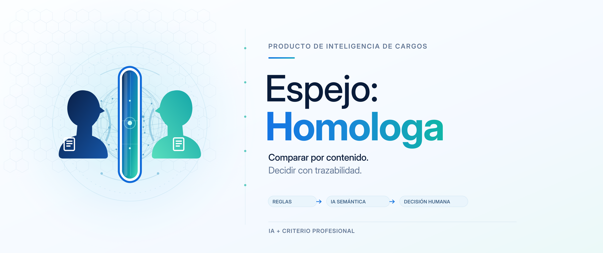

<div align="center">

<picture>
  <source media="(prefers-color-scheme: dark)" srcset="branding/espejo-banner-oscuro.png" />
  
</picture>

# Espejo-Homologa

**Comparar por contenido. Decidir con trazabilidad.**

[](#sobre-el-proyecto) [](#usar-o-descargar) [](LICENSING.md)

[](#tecnologías) [](#tecnologías) [](#tecnologías) [](#tecnologías)

[Abrir aplicación](https://espejo-homologa.lovable.app) · [Documentación](docs/README.md) · [Arquitectura](docs/01-arquitectura-general.md) · [Inicio rápido](#ejecutar-desde-el-código)

</div>

---

## Sobre el proyecto

Piloto web para homologar cargos por su contenido: importa planillas, compara con reglas e interpretación semántica y conserva la decisión del analista. La remuneración se consulta después como benchmark; no determina la homologación.

**Estado:** Piloto web con servidor. Surgió del curso externo Duplas Intergeneracionales de DesafíoLatam, patrocinado por Entel. No hay instaladores publicados en GitHub Releases.

## Tecnologías

| Área                       | Tecnologías y responsabilidad                                                   |
| -------------------------- | ------------------------------------------------------------------------------- |
| **Aplicación**             | React 19, TypeScript, TanStack Start y Tailwind CSS.                            |
| **Datos**                  | PostgreSQL gestionado en Lovable Cloud/Supabase, con funciones de servidor.     |
| **Análisis e intercambio** | Motor determinístico, Gemini con respaldo Groq y planillas Excel mediante xlsx. |

> **Enfoque técnico:** Reglas, interpretación semántica y decisión humana son etapas separadas.

## Usar o descargar

[Abrir la aplicación](https://espejo-homologa.lovable.app) · [Flujo del analista](docs/03-flujo-de-usuario.md). Utiliza datos de prueba al explorar: el entorno publicado y la vista previa comparten backend.

## Ejecutar desde el código

Con Bun y acceso al entorno de prueba descrito en [configuración y despliegue](docs/09-deploy-y-entorno.md), desde la raíz:

```sh
bun install --frozen-lockfile
bun run dev
```

Las pantallas de datos requieren el backend configurado. Las claves de administración y proveedores se mantienen en el servidor.

## Documentación

[Índice completo y rutas de lectura](docs/README.md) · [Importación de planillas](docs/05-importacion-excel.md).

| Tipo                | Lectura                                                                                                                                                                          |
| ------------------- | -------------------------------------------------------------------------------------------------------------------------------------------------------------------------------- |
| General             | [Problema, cliente y solución](docs/00-problematica-cliente-y-valor.md) · [Motivación](docs/16-motivacion-y-contexto.md)                                                         |
| Técnica             | [Arquitectura y diagramas](docs/01-arquitectura-general.md) · [Dominio y datos](docs/04-base-de-datos.md)                                                                        |
| Desarrollo          | [Etapas y metodología](docs/17-desarrollo-y-metodologia.md) · [Proyección](docs/15-escalabilidad-y-nuevos-mercados.md) · [Costos CLP/USD](docs/18-analisis-economico-clp-usd.md) |
| Académica/formativa | [Contexto e informes originales](docs/academica/README.md)                                                                                                                       |

[Identidad visual](branding/README.md): logos, banners y variantes de aplicación.

## Licencia y créditos

Código y documentación propios: [PolyForm Noncommercial 1.0.0](LICENSE), con [atribución](NOTICE). Uso comercial fuera de sus permisos: acuerdo previo de créditos y compensación. [Alcance y contacto](LICENSING.md).
