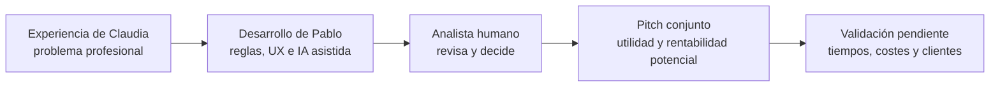

<picture>
  <source media="(prefers-color-scheme: dark)" srcset="../branding/logos/espejo-logo-horizontal-oscuro.svg" />
  
</picture>

# Documentación del proyecto

_Un recorrido desde el problema experto y el pitch hasta el motor, la IA, la decisión humana y la viabilidad._

La documentación se organiza en cuatro áreas: **general, técnica y desarrollo**, más una **formativa** especialmente relevante aquí porque Espejo nació en un proyecto de duplas y culminó con un pitch presentado ante un jurado. Las [cifras de esa presentación](formativa/02-pitch-y-vision.md) son hipótesis o referencias de contexto, **no resultados medidos del producto**.

## Rutas de lectura

| Área           | Contenido                                        | Documentos                                                                                                                                                                                                                                                                                                                                                      |
| -------------- | ------------------------------------------------ | --------------------------------------------------------------------------------------------------------------------------------------------------------------------------------------------------------------------------------------------------------------------------------------------------------------------------------------------------------------- |
| **General**    | Problema, alcance y trabajo del analista.        | [Propósito y alcance](general/01-proposito-y-alcance.md) · [Uso paso a paso](general/02-recorrido-del-analista.md) · [Valor y escalabilidad](general/03-propuesta-de-valor.md)                                                                                                                                                                                                                                              |
| **Técnica**    | Comparación de cargos, datos y resultados.       | [Arquitectura](tecnica/01-arquitectura.md) · [Dominio y datos](tecnica/02-dominio-y-datos.md) · [Motor](tecnica/03-motor-deterministico.md) · [IA](tecnica/04-ia-y-normalizacion.md) · [Flujos y estados](tecnica/05-flujos-y-estados.md) · [Entradas y salidas](tecnica/06-importacion-y-exportacion.md) · [Seguridad](tecnica/07-seguridad-y-limitaciones.md) |
| **Desarrollo** | Instalación, mantenimiento y mejoras pendientes. | [Entorno y despliegue](desarrollo/01-entorno-y-despliegue.md) · [Validación](desarrollo/02-validacion-y-mantenimiento.md) · [Prioridades](desarrollo/03-evolucion-y-prioridades.md) · [Métricas](desarrollo/04-viabilidad-y-metricas.md) · [Investigación externa y escenarios de rentabilidad](desarrollo/05-evidencia-externa-y-escenarios.md)                                                                                                                                                                             |
| **Formativa**  | Origen del proyecto, colaboración y aprendizaje. | [Historia de la dupla](formativa/README.md) · [Método y fuentes](formativa/01-metodologia-y-fuentes.md) · [Pitch y visión](formativa/02-pitch-y-vision.md) · [Atribuciones](formativa/03-colaboracion-y-atribucion.md)                                                                                                                                                                                                                                                         |

## De construir un prototipo a defender su valor

[Cómo se presentó la solución](formativa/02-pitch-y-vision.md) · [Qué falta para acreditar rentabilidad](desarrollo/04-viabilidad-y-metricas.md) · [Fuentes oficiales y análisis en CLP](desarrollo/05-evidencia-externa-y-escenarios.md).

## El sistema, de un vistazo

La [arquitectura por niveles](tecnica/01-arquitectura.md) contiene diagramas de contexto, contenedores, componentes y despliegue. [Dominio y datos](tecnica/02-dominio-y-datos.md) describe las entidades y sus relaciones; [flujos y estados](tecnica/05-flujos-y-estados.md) explica la actividad, la secuencia de operaciones y los estados persistidos. Los diagramas Mermaid se pueden editar en los propios documentos; las versiones SVG y DOT están en [`assets/diagramas`](assets/diagramas).

[Volver a la portada](../README.md)
