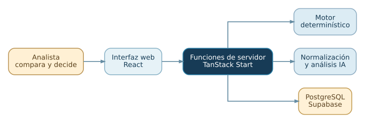

<picture>
  <source media="(prefers-color-scheme: dark)" srcset="../branding/logos/espejo-logo-horizontal-oscuro.svg" />
  
</picture>

# Documentación

*Una guía para entender el problema, revisar cómo funciona el software y continuar desarrollándolo.*

La documentación se organiza en cuatro áreas: propósito y uso, funcionamiento técnico, desarrollo e historia del proyecto.

## Elige tu ruta

| Área | Primero | Después |
| --- | --- | --- |
| **General** | [Por qué existe y hasta dónde llega](general/01-proposito-y-alcance.md) | [Cómo lo usa un analista](general/02-recorrido-del-analista.md) |
| **Técnica** | [Arquitectura y límites](tecnica/01-arquitectura.md) | [Modelo de datos](tecnica/02-dominio-y-datos.md) · [Motor](tecnica/03-motor-deterministico.md) |
| **Desarrollo** | [Arranque y despliegue](desarrollo/01-entorno-y-despliegue.md) | [Mantenimiento y pruebas](desarrollo/02-validacion-y-mantenimiento.md) |
| **Formativa** | [La dupla, el contexto y los aprendizajes](formativa/README.md) | [Método de trabajo](formativa/01-metodologia-y-fuentes.md) |

## Mapa del sistema

[Diagrama editable y arquitectura por niveles](tecnica/01-arquitectura.md).

## Índice técnico completo

| Capítulo | Qué responde |
| --- | --- |
| [01 · Arquitectura](tecnica/01-arquitectura.md) | ¿Qué se ejecuta en el navegador, servidor y servicios externos? Diagramas de contexto, contenedores y componentes. |
| [02 · Dominio y datos](tecnica/02-dominio-y-datos.md) | ¿Qué se persiste y cómo se relacionan los registros? Modelo de dominio y ER. |
| [03 · Motor determinístico](tecnica/03-motor-deterministico.md) | ¿Cómo se calculan los puntajes y descartes? Reglas, pesos y datos faltantes. |
| [04 · IA y normalización](tecnica/04-ia-y-normalizacion.md) | ¿Qué se envía a los modelos y qué ocurre si fallan? |
| [05 · Flujos y estados](tecnica/05-flujos-y-estados.md) | ¿Cómo se encadenan las operaciones y qué estados se guardan? Diagramas de actividad, secuencia y estados. |
| [06 · Entradas y salidas](tecnica/06-importacion-y-exportacion.md) | ¿Cómo se importan planillas y se construyen los informes? |
| [07 · Seguridad y límites](tecnica/07-seguridad-y-limitaciones.md) | Controles de acceso y requisitos para trabajar con datos reales. |

[Presentación del proyecto](../README.md) · [Próximos pasos](../roadmap.md).
