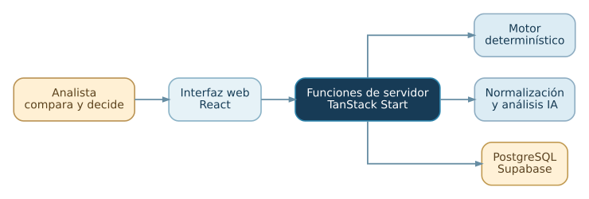

<picture>
  <source media="(prefers-color-scheme: dark)" srcset="../branding/logos/espejo-logo-horizontal-oscuro.svg" />
  
</picture>

# Documentación del proyecto

_Una guía para conocer la propuesta, utilizar la aplicación y continuar su desarrollo._

Homologa es el piloto implementado. Los capítulos de visión, arquitectura de expansión y nuevos pilotos describen propuestas para llevar su método de comparación a otros problemas.

## General

| Documento                                                           | Contenido                                                   |
| ------------------------------------------------------------------- | ----------------------------------------------------------- |
| [01 · Propósito y alcance](general/01-proposito-y-alcance.md)       | Problema, usuarios y alcance del piloto                     |
| [02 · Recorrido del analista](general/02-recorrido-del-analista.md) | Datos, comparación, decisión e informes                     |
| [03 · Propuesta de valor](general/03-propuesta-de-valor.md)         | Utilidad profesional y posibles modelos de servicio         |
| [04 · Visión de plataforma](general/04-vision-de-plataforma.md)     | Postulaciones, servicios y competencias como líneas futuras |

## Técnica

| Documento                                                                 | Contenido                                               |
| ------------------------------------------------------------------------- | ------------------------------------------------------- |
| [01 · Arquitectura](tecnica/01-arquitectura.md)                           | Navegador, servidor y servicios externos                |
| [02 · Dominio y datos](tecnica/02-dominio-y-datos.md)                     | Entidades, tablas y trazabilidad                        |
| [03 · Motor determinístico](tecnica/03-motor-deterministico.md)           | Reglas, pesos, puntajes y descartes                     |
| [04 · IA y normalización](tecnica/04-ia-y-normalizacion.md)               | Datos enviados, validación y fallos de proveedor        |
| [05 · Flujos y estados](tecnica/05-flujos-y-estados.md)                   | Actividad, secuencia y persistencia                     |
| [06 · Importación y exportación](tecnica/06-importacion-y-exportacion.md) | Planillas, benchmark e informes                         |
| [07 · Seguridad y limitaciones](tecnica/07-seguridad-y-limitaciones.md)   | Controles actuales y requisitos pendientes              |
| [08 · Arquitectura de expansión](tecnica/08-arquitectura-de-expansion.md) | Diseño propuesto de adaptadores y políticas por dominio |

## Desarrollo

| Documento                                                                               | Contenido                                             |
| --------------------------------------------------------------------------------------- | ----------------------------------------------------- |
| [01 · Entorno y despliegue](desarrollo/01-entorno-y-despliegue.md)                      | Dependencias, variables y migraciones                 |
| [02 · Validación y mantenimiento](desarrollo/02-validacion-y-mantenimiento.md)          | Pruebas y mapa de mantenimiento                       |
| [03 · Evolución y prioridades](desarrollo/03-evolucion-y-prioridades.md)                | Seguridad, historial, calidad y accesibilidad         |
| [04 · Viabilidad y métricas](desarrollo/04-viabilidad-y-metricas.md)                    | Medición de tiempos, calidad y costos                 |
| [05 · Evidencia externa y escenarios](desarrollo/05-evidencia-externa-y-escenarios.md)  | Fuentes y análisis económico con supuestos explícitos |
| [06 · Expansión y pilotos](desarrollo/06-expansion-y-pilotos.md)                        | Secuencia de experimentos y criterios para avanzar    |
| [07 · Mercado y posicionamiento](desarrollo/07-estudio-de-mercado-y-posicionamiento.md) | Compradores, competencia y oportunidades de entrada   |

## Formativa

| Documento                                                                   | Contenido                                       |
| --------------------------------------------------------------------------- | ----------------------------------------------- |
| [Historia de la dupla](formativa/README.md)                                 | Origen, colaboración y aprendizaje              |
| [01 · Metodología y fuentes](formativa/01-metodologia-y-fuentes.md)         | Etapas y guías del curso                        |
| [02 · Pitch y visión](formativa/02-pitch-y-vision.md)                       | Las siete diapositivas de la presentación final |
| [03 · Colaboración y atribución](formativa/03-colaboracion-y-atribucion.md) | Participación y créditos                        |

## El sistema, de un vistazo

Los diagramas Mermaid se pueden editar en los propios capítulos. Las versiones SVG y DOT están en [`assets/diagramas`](assets/diagramas).

[Volver a la portada](../README.md) · [Roadmap](../roadmap.md)
