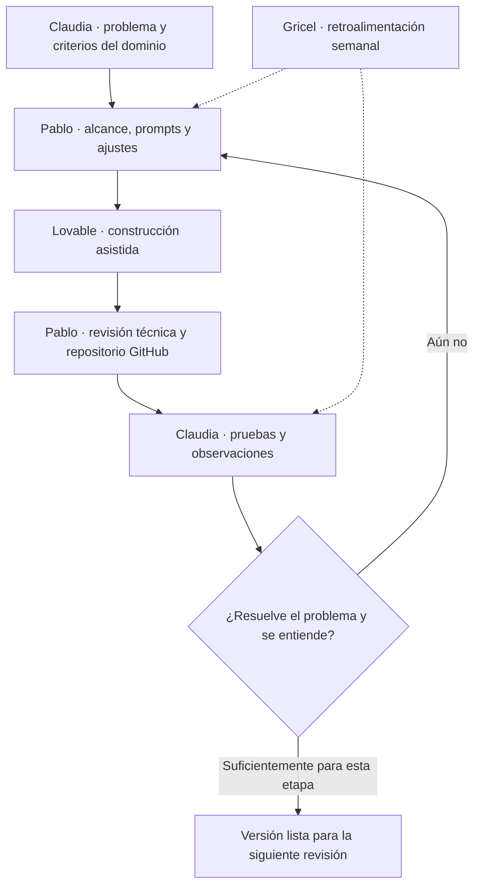

# Cómo trabajamos · Del problema a los prompts y las pruebas

El curso combinaba ejercicios técnicos con el desarrollo de un proyecto en dupla. En Espejo usamos ese trabajo para pasar de la descripción del problema a un prototipo que Claudia podía probar.

## Dos bloques de trabajo

El curso distinguía un **bloque técnico**, donde se aprendían habilidades sobre casos de práctica, y un **bloque de proyectos**, donde cada dupla aplicaba esas habilidades a su propio desafío. En el primero se trabajaba la secuencia *describir → construir → ajustar → publicar*, los briefs o instrucciones para Lovable, las tablas y relaciones, la navegación, los estados, los filtros, los resúmenes de datos y la revisión de usabilidad. En el segundo se ejercitaba la formulación de un problema verificable y la validación de un prototipo con personas.

Las guías organizaban el bloque de proyectos de esta manera:

| Etapa | Propósito |
| --- | --- |
| **Match Day y V0** | Formar la dupla, acordar cómo colaborar, escoger un desafío y construir un primer boceto exploratorio. |
| **Investigación y diagnóstico** | Confrontar la idea inicial con el problema real y aclarar qué valor puede aportar. |
| **Definición de alcance** | Distinguir lo esencial de lo deseable y fijar un criterio de éxito comprobable. |
| **Versión funcional V1** | Construir una demostración que permita recorrer la tarea principal. |
| **Iteración y validación / V2** | Recoger observaciones de uso, contrastarlas con la revisión apoyada por IA y ajustar la solución. |
| **Presentación final** | Explicar el problema, mostrar el prototipo, contar lo aprendido y responder preguntas de un panel. |

## Nuestra iteración, en la práctica

Claudia describía situaciones y criterios que conocía por su experiencia profesional. Yo los traducía a prompts, probaba los cambios en Lovable y me apoyaba en ChatGPT para ajustar las instrucciones. GitHub nos permitía revisar y conservar las versiones del código.

Luego Claudia probaba la aplicación y señalaba lo que encontraba útil, confuso o incompleto. Usábamos sus observaciones para decidir el siguiente ajuste y revisábamos los avances en las reuniones semanales con Gricel Sepúlveda.

## Accesibilidad y pruebas de uso

Queríamos que alguien que no hubiese construido el sistema pudiera entender qué estaba viendo y qué acción debía realizar. Las pruebas con Claudia nos llevaron a revisar las etiquetas, la navegación, el tamaño del texto y las explicaciones de los resultados.

Queda pendiente ampliar las pruebas a más personas y realizar una evaluación de accesibilidad.

## Dos usos distintos de la inteligencia artificial

- **IA para desarrollar Espejo:** Lovable y ChatGPT fueron herramientas de apoyo para convertir instrucciones en cambios, revisar ideas e iterar sobre el prototipo. El repositorio GitHub nos permitió conservar y continuar ese trabajo.
- **IA dentro de Espejo:** la aplicación normaliza requisitos y compara el contenido de los cargos, como se explica en [IA y normalización](../tecnica/04-ia-y-normalizacion.md).

[Volver al origen](README.md) · [Índice general](../README.md).
