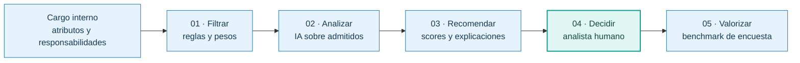

# 02 · El pitch de Espejo: del prototipo a una propuesta defendible

[← Experiencia formativa](README.md) · [Valor y alcance comercial](../general/03-propuesta-de-valor.md) · [Medición y viabilidad](../desarrollo/04-viabilidad-y-metricas.md)

La presentación final de siete diapositivas expuso la propuesta de Homologa ante el jurado de Duplas Intergeneracionales Tech. Este capítulo recoge su argumento y distingue las cifras de la presentación de las mediciones pendientes.

## Presentar una solución tecnológica

El trabajo en **Duplas Intergeneracionales Tech** no terminaba en hacer funcionar la aplicación. Había que identificar una necesidad real, acotar el problema, construir una propuesta que pudiera demostrarse y **explicar por qué valía la pena adoptarla ante un jurado**.

**Claudia Peña** aportó la perspectiva profesional del problema; **Pablo Guzmán** explicó cómo las reglas, la IA y el diseño de la herramienta la llevaban a un flujo demostrable. Ambos presentaron la propuesta. [Créditos y responsabilidades](03-colaboracion-y-atribucion.md).

La experiencia del analista era parte esencial del servicio: interpretar responsabilidades, revisar los candidatos y confirmar la equivalencia. La herramienta buscaba reducir trabajo repetitivo y ordenar esa revisión.

## El relato en siete diapositivas

| Lámina del pitch       | Mensaje                                                                                                | Relación con lo implementado                                                           |
| ---------------------- | ------------------------------------------------------------------------------------------------------ | -------------------------------------------------------------------------------------- |
| **1 · Proyecto**       | «Transformar análisis experto en decisiones trazables»; aparecen Claudia y Pablo como presentadores    | Visión y equipo del proyecto, no una certificación comercial                           |
| **2 · Mensaje**        | Un mismo nombre de cargo no demuestra el mismo trabajo; necesitamos equivalencias defendibles          | Motor por atributos, no solo coincidencia nominal                                      |
| **3 · Contexto**       | Cargo interno → comparación → remuneración de mercado; una mala homologación distorsiona la referencia | Separación de la equivalencia por contenido y del benchmark salarial                   |
| **4 · Método**         | **Filtrar → analizar → recomendar → decidir → valorizar**                                              | Motor determinístico → IA semántica opcional → preselección/decisión humana → bandas   |
| **5 · Gobernanza**     | IA compara, explica y recomienda; el profesional revisa, descarta, confirma y decide                   | La salida del modelo no escribe por sí sola una homologación final                     |
| **6 · Demostración**   | Recorrido de un cargo interno a una recomendación fundamentada                                         | Prototipo web enlazado mediante QR en el material presentado                           |
| **7 · Valor y cierre** | Consistencia, eficiencia y trazabilidad; «La IA no reemplaza al experto. Potencia su trabajo»          | Propuesta de valor y **beneficios por validar**, no resultados productivos acreditados |

### Cómo explicar el método en una sola imagen

El diagrama simplifica el discurso de presentación. En la implementación, **la IA es opcional**; cuando falla, el analista puede continuar con las comparaciones del motor. La etapa final de remuneración utiliza **bandas de encuesta**, no el sueldo como variable del score. [Flujos reales](../tecnica/05-flujos-y-estados.md).

## Cifras del pitch y medición pendiente

El pitch utilizó tres cifras como referencias del problema y beneficios potenciales. La tabla indica la evidencia necesaria para evaluarlas.

| Cifra en la presentación                            | Diapositiva | Clasificación responsable                                                                                                               |
| --------------------------------------------------- | ----------- | --------------------------------------------------------------------------------------------------------------------------------------- |
| **«2 horas por homologación»**                      | 2           | **Referencia del problema**, no duración observada en una muestra documentada                                                           |
| **«Hasta 15 % de desviación de mercado»**           | 2           | **Advertencia ilustrativa**; la diapositiva menciona «Mercer, 2024» sin identificar aquí publicación, página y metodología comprobables |
| **«Hasta 80 % menos tiempo de análisis por cargo»** | 7           | **Meta o beneficio potencial del pitch**, no reducción alcanzada y verificada con datos del piloto                                      |

Estas cifras describen el argumento presentado. Para utilizarlas como indicadores de desempeño se necesita una línea base y una comparación controlada.

La observación posterior de Pablo sobre el tiempo de uso está documentada, junto con sus condiciones, en [evidencia y escenarios](../desarrollo/05-evidencia-externa-y-escenarios.md).

Para convertirlos en evidencia verificable hace falta el [protocolo de medición](../desarrollo/04-viabilidad-y-metricas.md): muestra de pares de cargos, criterio de aceptación profesional, tiempos antes/después, costes y tratamiento de errores.

## La visión profesional que inspiró el cierre

La propuesta se centró en ampliar la capacidad del especialista para interpretar responsabilidades, explicar descartes y asesorar con información ordenada.

Pablo plantea que la especialización y las herramientas digitales pueden ampliar las opciones de consultoría y trabajo independiente. Esa visión orienta la propuesta de expansión posterior al curso.

### Una segunda idea que surgió al revisar la escalabilidad

La ampliación a nuevos casos de uso fue propuesta por Pablo después del pitch.

Homologa ofrece un precedente para comparar descripciones con criterios explícitos, una lectura auxiliar de IA y revisión profesional. Aplicar ese método a postulaciones y servicios requiere nuevos modelos, reglas y pruebas.

La [visión extendida](../general/04-vision-de-plataforma.md) y la [ruta de pilotos](../desarrollo/06-expansion-y-pilotos.md) describen esa evolución.

### Próximos pasos

La [validación de eficiencia y viabilidad](../desarrollo/04-viabilidad-y-metricas.md) debe medir calidad, tiempo completo, costos y disposición a pagar antes de convertir los beneficios propuestos en compromisos comerciales.

[Presentación de la dupla](README.md) · [Propuesta de servicio](../general/03-propuesta-de-valor.md) · [Atribución](03-colaboracion-y-atribucion.md).
