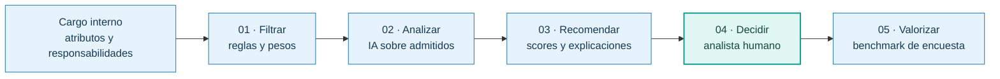

# 02 · El pitch de Espejo: del prototipo a una propuesta defendible

[← Experiencia formativa](README.md) · [Valor y alcance comercial](../general/03-propuesta-de-valor.md) · [Medición y viabilidad](../desarrollo/04-viabilidad-y-metricas.md)

> **Documento de contexto del proyecto de duplas, no una ficha comercial con resultados validados.** Se reconstruye el argumento a partir de la presentación final de **siete diapositivas** compartida por la dupla. El archivo original de la presentación no se agrega a este repositorio: puede contener elementos gráficos o créditos cuya distribución debe acordarse.

## También aprendimos a vender una solución tecnológica

El trabajo en **Duplas Intergeneracionales Tech** no terminaba en hacer funcionar la aplicación. Había que identificar una necesidad real, acotar el problema, construir una propuesta que pudiera demostrarse y **explicar por qué valía la pena adoptarla ante un jurado**.

En nuestro caso, ese ejercicio conectó dos aportes: **Claudia Peña** podía defender el sentido profesional de homologar cargos por contenido; **Pablo Guzmán** podía explicar cómo las reglas, la IA y el diseño de la herramienta convertían ese criterio en un flujo técnico demostrable. Ambos presentamos la propuesta. [Créditos y responsabilidades](03-colaboracion-y-atribucion.md).

No se presentó al analista como un obstáculo que debíamos automatizar. **Su experiencia era parte esencial del servicio**. La tecnología podía disminuir trabajo repetitivo, estructurar la búsqueda y registrar recomendaciones, pero debía dejarle a la persona la responsabilidad de confirmar la equivalencia.

## Cómo construimos el relato en siete diapositivas

| Lámina del pitch | Mensaje | Relación con lo implementado |
| --- | --- | --- |
| **1 · Proyecto** | «Transformar análisis experto en decisiones trazables»; aparecen Claudia y Pablo como presentadores | Visión y equipo del proyecto, no una certificación comercial |
| **2 · Mensaje** | Un mismo nombre de cargo no demuestra el mismo trabajo; necesitamos equivalencias defendibles | Motor por atributos, no solo coincidencia nominal |
| **3 · Contexto** | Cargo interno → comparación → remuneración de mercado; una mala homologación distorsiona la referencia | Separación de la equivalencia por contenido y del benchmark salarial |
| **4 · Método** | **Filtrar → analizar → recomendar → decidir → valorizar** | Motor determinístico → IA semántica opcional → preselección/decisión humana → bandas |
| **5 · Gobernanza** | IA compara, explica y recomienda; el profesional revisa, descarta, confirma y decide | La salida del modelo no escribe por sí sola una homologación final |
| **6 · Demostración** | Recorrido de un cargo interno a una recomendación fundamentada | Prototipo web enlazado mediante QR en el material presentado |
| **7 · Valor y cierre** | Consistencia, eficiencia y trazabilidad; «La IA no reemplaza al experto. Potencia su trabajo» | Propuesta de valor y **beneficios por validar**, no resultados productivos acreditados |

### Cómo explicar el método en una sola imagen

El diagrama simplifica el discurso de presentación. En la implementación, **la IA es opcional**; cuando falla, el analista puede continuar con las comparaciones del motor. La etapa final de remuneración utiliza **bandas de encuesta**, no el sueldo como variable del score. [Flujos reales](../tecnica/05-flujos-y-estados.md).

## Cifras del pitch: conservar sin inflarlas

La presentación contiene tres cifras visuales importantes, pero **no adjunta las mediciones primarias, base de comparación o protocolo experimental** necesarios para tratarlas como resultados comprobados.

| Cifra en la presentación | Diapositiva | Clasificación responsable |
| --- | --- | --- |
| **«2 horas por homologación»** | 2 | **Referencia del problema**, no duración observada en una muestra documentada |
| **«Hasta 15 % de desviación de mercado»** | 2 | **Advertencia ilustrativa**; la diapositiva menciona «Mercer, 2024» sin identificar aquí publicación, página y metodología comprobables |
| **«Hasta 80 % menos tiempo de análisis por cargo»** | 7 | **Meta o beneficio potencial del pitch**, no reducción alcanzada y verificada con datos del piloto |

Estos números forman parte **del material efectivamente presentado**; no deben eliminarse de la historia. Pero tampoco es correcto convertirlos en «80 % de ahorro demostrado», «15 % de error de clientes» o «dos horas medidas en Inmomaq/una empresa real».

Para convertirlos en evidencia verificable hace falta el [protocolo de medición](../desarrollo/04-viabilidad-y-metricas.md): muestra de pares de cargos, criterio de aceptación profesional, tiempos antes/después, costes y tratamiento de errores.

## La visión profesional que inspiró el cierre

Para nosotros, una herramienta así tenía valor cuando **aumentaba la capacidad de un especialista para entregar servicios de mayor calidad**. En lugar de prometer «IA que reemplaza al analista», presentamos un modo en que la persona podía concentrarse en resolver lo complejo: interpretar responsabilidades, explicar descartes, discutir equivalencias y asesorar en decisiones.

**Perspectiva personal de Pablo, más amplia que las siete láminas:** imagino un futuro donde la especialización, la reputación y la capacidad de ofrecer servicios concretos tendrán un peso creciente. Un profesional podrá complementar un empleo con trabajo independiente, consultoría o soluciones apoyadas en tecnología. No es una afirmación de que **todos** los trabajos de salario fijo desaparecerán, ni una conclusión respaldada por esta presentación. Lo que sí demuestra el caso de Espejo es cómo una herramienta puede **hacer más transferible y escalable el conocimiento profesional sin quitar la decisión a su titular**.

### Qué no probó la presentación

- No se incluyó un **estado de resultados**, una tarifa efectivamente cobrada, clientes que hayan contratado, ingresos, margen ni retorno de inversión validado.
- La capacidad de vender el servicio o replicarlo en otras organizaciones es una **hipótesis de negocio**; no acredita multi-tenencia, seguridad productiva ni una operación comercial instalada.
- Los puntajes de la IA son recomendaciones de equivalencia, **no predicciones de salario** ni evaluaciones de personas.

El pitch fue importante como **ejercicio de comunicación, posicionamiento y propuesta de valor**. Su resultado no debe confundirse con las pruebas técnicas que exige un producto comercial.

[Presentación de la dupla](README.md) · [Propuesta de servicio](../general/03-propuesta-de-valor.md) · [Atribución](03-colaboracion-y-atribucion.md).
