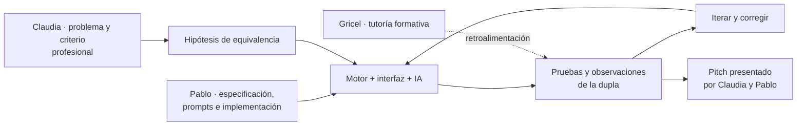

# 03 · Personas, colaboración y atribuciones

[← Historia de la dupla](README.md) · [Pitch](02-pitch-y-vision.md) · [Licencia](../../LICENSING.md)

Espejo nació en un contexto de aprendizaje colaborativo, **no** en el trabajo de una sola persona ni en un encargo comercial acreditado. Debemos reconocer tanto el conocimiento del dominio como la implementación y la presentación de la propuesta.

## Participación humana documentada

| Persona | Participación descrita en la documentación del proyecto | Lo que no corresponde inferir |
| --- | --- | --- |
| **Claudia Peña** | Economista y profesional vinculada al problema de compensaciones; aportó **casos, criterios de homologación y revisión de resultados**, probó la interfaz y participó en la presentación | No atribuirle autoría de código específico, participación financiera o cesión de derechos sin evidencia |
| **Pablo Guzmán** | Estudiante de informática; transformó requisitos en prompts, **condujo las iteraciones técnicas con Lovable**, revisó cambios, organizó GitHub y participó en la presentación | No convertir la administración del repositorio en declaración automática de propiedad exclusiva sobre todos los aportes |
| **Gricel Sepúlveda** | **Tutora**: acompañó y retroalimentó semanalmente el proyecto | No presentarla como desarrolladora, propietaria, co-presentadora o integrante de la dupla |

**Herramientas utilizadas en el desarrollo:** Lovable y ChatGPT como apoyo para construir y revisar software. **IA que participa dentro de la aplicación:** Gemini y, en ciertos errores transitorios, Groq. Ninguna herramienta es un colaborador humano con la función profesional de Claudia o Pablo.

La presentación final de siete láminas identifica expresamente **Claudia Peña** y **Pablo Guzmán** en su portada. La tutoría de Gricel se acredita por los documentos formativos del proyecto, no como autora del pitch.

## De dónde surgieron las decisiones

Esta organización explica la colaboración sin afirmar que cada herramienta, archivo o decisión tenga necesariamente un único titular.

## Derechos sobre código, datos, marca y presentación

- **Código y documentación:** `LICENSE` incorpora PolyForm Noncommercial 1.0.0. La capacidad de licenciar se limita a los **derechos efectivamente controlados por quien concede el permiso**. La co-creación en el curso puede requerir aclarar acuerdos de contribución o cesiones antes de negociar licencias comerciales.
- **Conocimiento profesional y criterios:** el aporte de Claudia al dominio y al relato comercial debe reconocerse. No se deben publicar ejemplos o datos de clientes reales sin permiso, aunque hayan inspirado el producto.
- **Identidad gráfica y diapositivas:** los archivos de `branding/` incluyen una referencia de diseño. No se ha verificado aquí la procedencia de todos los elementos ni los derechos para republicar la **presentación completa**, por lo que el PDF compartido para la auditoría **no se incorpora automáticamente** al repositorio.
- **Tutoría y programa:** Gricel, Desafío Latam y Fondo 55+ Entel se mencionan como contexto formativo según las fuentes del repositorio, **no** como titulares o patrocinadores comerciales de la herramienta.

## Qué faltaría definir antes de vender

No existe en el material revisado un **reparto de regalías**, sociedad, acuerdo de explotación, contrato de comercialización ni asignación exclusiva de propiedad intelectual. **No sería responsable inventarlos.** Antes de vender consultoría, licencias o servicios bajo Espejo, la dupla debería acordar por escrito el uso de la marca, los créditos, las autorizaciones del código y las contribuciones que corresponda reconocer.

**Crédito breve recomendado para el proyecto:**

> Proyecto colaborativo de Duplas Intergeneracionales Tech. Claudia Peña: conocimiento profesional de homologación, criterios y validación funcional. Pablo Guzmán: especificación, desarrollo e iteración técnica asistidos por IA. Tutoría: Gricel Sepúlveda.

Este crédito **reconoce contribuciones**, no crea ni modifica derechos de autor por sí mismo.

[Historia](README.md) · [Metodología](01-metodologia-y-fuentes.md) · [Licencias](../../LICENSING.md).
