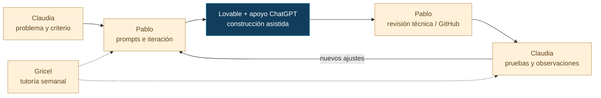

# Espejo · Homologa, la historia detrás del código

El proyecto nació de la colaboración entre dos personas con trayectorias distintas: la experiencia profesional de Claudia Peña en recursos humanos y la formación técnica de Pablo Guzmán. **Además de construir una aplicación, debíamos aprender a explicar su alcance, defender sus beneficios y vender una solución tecnológica en una presentación ante un jurado.** La dupla preparó un pitch que conectó problema, gobernanza de IA, demostración y valor potencial.

## Cómo comenzó

La dupla se formó en **Duplas Intergeneracionales Tech**, programa de **Desafío Latam** vinculado al **Fondo 55+ Entel**. **Pablo Guzmán**, estudiante de **Ingeniería Civil en Computación e Informática**, participó en el rol _junior_. **Claudia Peña**, economista con experiencia en recursos humanos, incluido el **sector sanitario**, participó en el rol _senior_.

Claudia planteó una dificultad que conocía en su trabajo: comparar cargos que, entre organizaciones y encuestas, pueden nombrarse o describirse de maneras distintas. Ese problema dio origen a Espejo y orientó la definición de sus criterios de homologación.

## Qué hizo cada persona

**Claudia** aportó casos, criterios del rubro y pruebas de uso. Sus observaciones ayudaron a ajustar los resultados, la claridad de la interfaz y la facilidad para recorrerla.

**Pablo** redactó los prompts, condujo las iteraciones con **Lovable** y organizó el trabajo técnico con apoyo de **ChatGPT** y **GitHub**. Su formación le permitió interpretar lo generado y traducir las observaciones de Claudia en cambios de la aplicación.

**Gricel Sepúlveda**, tutora del proyecto, entregó retroalimentación semanal para revisar los avances y orientar las siguientes decisiones.

## El ciclo de trabajo

Cada observación de Claudia se convertía en un objetivo de implementación. Pablo preparaba las instrucciones, revisaba la respuesta de Lovable y comprobaba los cambios. Claudia probaba la nueva versión y aportaba comentarios para la siguiente iteración. La tutoría semanal permitía contrastar los avances con los objetivos del curso.

## La perspectiva intergeneracional

Las distintas trayectorias permitieron revisar tanto la implementación como su utilidad profesional. Pablo se concentró en convertir las decisiones en una aplicación; Claudia evaluó si lo que aparecía en pantalla tenía sentido para el análisis de cargos.

Esa colaboración también se refleja en el producto: el motor y la IA aportan información, y el analista confirma la homologación con conocimiento del contexto.

## Aprender a presentar y ofrecer un servicio

El pitch final no se redujo a enumerar funciones. Mostramos por qué **un mismo nombre no equivale necesariamente al mismo trabajo**, describimos el flujo de reglas e IA y destacamos que **la decisión final sigue siendo del profesional**. Después demostramos la aplicación y defendimos la propuesta de consistencia, eficiencia y trazabilidad.

Las cifras del material —**2 horas por caso**, **hasta 15 % de desviación** y **hasta 80 % menos tiempo**— deben conservarse como **referencias e hipótesis del pitch**, no como resultados que ya hayamos medido. No se adjuntaron en esa presentación los costos, los precios o la muestra necesaria para certificar rentabilidad.

Mi visión personal es que los profesionales podrán diferenciarse más mediante **especialización y servicios de alto valor**, con herramientas digitales que amplían sus capacidades. Eso **no implica** que esté demostrado el fin de todos los empleos de salario fijo. Lo que defendimos juntos fue algo más preciso: **la IA no reemplaza al experto, potencia su trabajo**.

[El pitch, lámina por lámina](02-pitch-y-vision.md) · [Atribución de la dupla](03-colaboracion-y-atribucion.md) · [Modelo de servicio](../general/03-propuesta-de-valor.md).

## Expansión pensada después del pitch

La propuesta original que defendimos ante el jurado fue **Homologa**, con criterios salariales solo al final del análisis de equivalencia. Posteriormente, Pablo planteó explorar el mismo **método de correspondencia explicable** para postulación, servicios de freelancers y necesidades de organizaciones. **Es una visión nueva**, no una funcionalidad entregada, una declaración de Claudia ni un contenido añadido retroactivamente a nuestra presentación. [La ampliación de Espejo](../general/04-vision-de-plataforma.md).

## Evaluación final

La dupla obtuvo **nota final 7,0**, máxima de la escala chilena, en la evaluación del curso.

[Etapas del curso y materiales consultados](01-metodologia-y-fuentes.md) · [Qué hace el piloto](../general/01-proposito-y-alcance.md) · [Pitch](02-pitch-y-vision.md) · [Créditos](03-colaboracion-y-atribucion.md) · [Volver al índice](../README.md)
