# 02 · Recorrido del analista

La interfaz guía la comparación desde la elección de un cargo interno hasta la confirmación de su referencia.

```mermaid
flowchart LR
  A[Preparar cargos<br/>y criterios] --> B[Elegir cargo<br/>interno]
  B --> C[Revisar fichas<br/>y ponderación]
  C --> D[Motor: candidatos<br/>y descartes]
  D --> E[IA: lectura<br/>semántica opcional]
  E --> F[Preseleccionar<br/>varios]
  F --> G[Confirmar uno<br/>como definitivo]
  G --> H[Consultar bandas<br/>y exportar]
  classDef blue fill:#163A58,color:#fff,stroke:#357EA3,stroke-width:2px;
  classDef light fill:#EAF3F7,color:#15374E,stroke:#8CAEBF;
  classDef gold fill:#FFF3D8,color:#533D12,stroke:#C89B42,stroke-width:2px;
  class A,B,C,D,E light;
  class F,G gold;
  class H blue;
```

## Antes de empezar

En **Cargos** se cargan cargos internos y referencias; en **Empresas** se administra la información de las empresas, y en **Diccionario** los códigos de áreas, subáreas y niveles. En **Criterios** se ajustan ponderaciones y requisitos obligatorios. Una planilla de remuneraciones puede aportar las bandas de una encuesta, si sus códigos coinciden con el catálogo.

## Durante la comparación

1. **Cargo:** elige un cargo interno y comprueba que exista un catálogo de referencia.
2. **Revisión:** revisa su ficha y las ponderaciones que se aplicarán. Puedes ajustar los pesos para esta ejecución sin cambiar los valores generales.
3. **Candidatos:** el motor calcula similitudes, muestra candidatos admitidos y diferencia los descartes por criterios obligatorios.
4. **Análisis IA:** el sistema intenta comparar semánticamente los candidatos del motor; si la IA falla, los puntajes determinísticos se conservan. Un score de IA ausente se muestra como pendiente, no como cero.
5. **Decisión:** marca uno o varios candidatos para examinarlos y consultar sus bandas salariales por tamaño. Confirma una sola referencia, con nombre de analista y comentario opcional. Consultar las bandas no cambia los puntajes.

## Después de confirmar

El historial conserva la ejecución, su análisis y la decisión. Desde allí puedes elegir el tamaño de empresa para consultar P25, P50, P75 y promedio, y exportar un informe Excel o un PDF para impresión. Las bandas se muestran cuando la encuesta contiene datos para el cargo y tamaño seleccionados.

El estado **Completada** indica que terminó el cálculo determinístico. El análisis IA y la confirmación del analista se registran por separado.

[Flujos y estados técnicos](../tecnica/05-flujos-y-estados.md) · [Volver al índice](../README.md).
