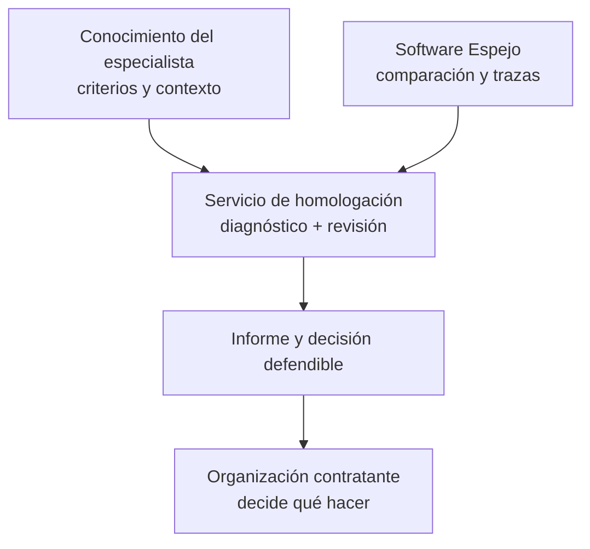

# 03 · Propuesta de valor, alcance y escalabilidad

[← General](../README.md) · [Historia del pitch](../formativa/02-pitch-y-vision.md) · [Viabilidad](../desarrollo/04-viabilidad-y-metricas.md)

## Qué problema estamos resolviendo

En compensaciones y análisis de cargos, el riesgo no es solo perder tiempo **buscando un nombre parecido**. Es utilizar una referencia salarial que no represente el contenido, responsabilidades o nivel del cargo que se quiere comparar.

**Espejo · Homologa** plantea una respuesta concreta: transformar la búsqueda de equivalencias en una secuencia revisable de criterios, candidatos, interpretación semántica y **decisión profesional**. **La remuneración aparece después**, cuando ya se eligió la referencia contra la que se consultará la encuesta.

El valor esperado es que la persona experta emplee menos esfuerzo en tareas repetitivas y más tiempo en justificar decisiones complejas. **Pablo reporta unos 2–3 minutos por homologación justificada en su flujo actual**, cuando las fichas están disponibles; **falta verificar el resultado con una muestra y una comparación controlada**, especialmente la preparación de datos y la revisión. Este dato es una observación, no un KPI demostrado. [Fuentes y sensibilidad económica](../desarrollo/05-evidencia-externa-y-escenarios.md).

## Qué puede ofrecer un profesional con Espejo

| Servicio posible | Qué aporta el producto hoy | Qué sigue dependiendo del experto |
| --- | --- | --- |
| Diagnóstico de un catálogo interno | Importación de cargos, criterios y calidad de fichas | Corregir descripción, contexto y ambigüedades del puesto |
| Preselección de referencias | Motor determinístico y descartes explicables | Evaluar qué referencias son comparables en la práctica |
| Segunda lectura del contenido | Análisis semántico opcional de los candidatos admitidos | Evaluar límites de la explicación y corregir interpretaciones |
| Decisión documentada | Marcar varios, confirmar uno, guardar nombre y comentario | **Asumir y defender la homologación escogida** |
| Contexto de remuneración | Bandas P25/P50/P75/promedio por tamaño y fuente/año | Interpretar mercado, vigencia, muestra y política de compensaciones |
| Entrega de resultados | Historial y reporte Excel / impresión PDF | Revisar y explicar el informe ante la organización |

El producto no contrata personal, no fija sueldos automáticamente, no determina valor profesional de personas y no reemplaza la consultoría especializada. **Un score no es una sentencia de equivalencia.**

## Producto, servicio y conocimiento: tres niveles

La escala del **servicio profesional** y la escala del **software** no son la misma cosa: repetir un procedimiento con varias empresas puede requerir especialistas, permisos sobre encuestas, aislamiento de información y controles que el piloto todavía no tiene.

## Públicos potenciales, no cartera de clientes demostrada

- **Consultores de compensaciones y recursos humanos:** apoyo estructurado en proyectos que requieren justificar equivalencias.
- **Áreas de personas de organizaciones:** trabajo de comparación interna contra cargos y referencias de encuesta.
- **Equipos de estudios y benchmarking:** proceso replicable con control de fuentes, años y tamaños de empresa.

Son **segmentos plausibles de valor**, no empresas clientes que hayan contratado el sistema. El uso de datos de encuestas debe respetar el contrato y los derechos de la fuente salarial.

## Caminos de monetización que podrían explorarse

**No existe una comercialización acreditada del piloto.** Se pueden evaluar alternativas futuras:

1. **Servicio por proyecto:** un especialista cobra por diagnóstico y homologaciones revisadas, utilizando Espejo como herramienta de trabajo.
2. **Consultoría recurrente:** mantenimiento de criterios, actualización de fuentes y revisión periódica de cargos, con alcance pactado.
3. **Licencia o instalación institucional:** acceso a software acompañado de soporte, seguridad y separación de organizaciones **solo después de implementar esos requisitos**.

No hay un precio, tarifa, porcentaje de regalías o modalidad ya acordada. El archivo [LICENSING.md](../../LICENSING.md) define límites de licencia del código y la necesidad de acuerdos escritos, **pero no constituye un contrato comercial de la dupla ni un reparto de ingresos**.

## Cómo hablar de escalabilidad sin prometerla antes de tiempo

| Dimensión | Lo que sí permite decir el piloto | Lo que requiere trabajo |
| --- | --- | --- |
| **Procedimiento** | Criterios reutilizables, fichas y flujos relativamente repetibles | Evaluar consistencia entre analistas y sectores |
| **Datos** | Importación, catálogos, historial y bandas por tamaño | Convenios de datos, actualización y validación de encuestas |
| **Cómputo e IA** | Procesamiento en servidor con proveedores externos | Límites, cuotas, reintentos, costes por ejecución y monitorización |
| **Organizaciones** | El modelo contiene empresas y cargos relacionados | Autenticación, autorización por organización y aislamiento real de datos |
| **Consultoría** | Presentación clara de la decisión humana y apoyo en reportes | Método operativo, capacitación, revisión profesional y gestión de calidad |
| **Ingresos** | Hipótesis de utilidad y posible disposición a pagar | Pilotos autorizados, entrevistas, precios y costes medidos |

**Restricción crítica:** las server functions consultan datos usando la clave de servicio de Supabase; no aplican de forma general autorización por organización antes de acceder a tablas. **No se debe ofrecer como SaaS multiempresa listo para datos confidenciales**. [Límites de seguridad](../tecnica/07-seguridad-y-limitaciones.md).

## La tesis de Espejo sobre el trabajo profesional

La evolución del trabajo digital puede aumentar el valor de **especialistas capaces de explicar problemas, formular criterios y entregar servicios propios**. Esta es una **visión estratégica** que motivó el pitch, no un pronóstico sobre la desaparición del empleo asalariado.

La fortaleza defendible de Espejo está en otra frase: **la IA no reemplaza al experto; potencia su trabajo**. El producto tiene sentido si la persona conserva la decisión, la responsabilidad, los criterios y la relación con quien necesita el servicio.

[Motor real](../tecnica/03-motor-deterministico.md) · [Gobernanza de IA](../tecnica/04-ia-y-normalizacion.md) · [Métricas y viabilidad](../desarrollo/04-viabilidad-y-metricas.md).
