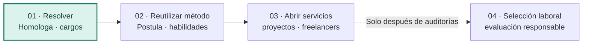

# 03 · Propuesta de valor y escalabilidad: de una comparación a muchos problemas

[← General](../README.md) · [Visión completa](04-vision-de-plataforma.md) · [El pitch original](../formativa/02-pitch-y-vision.md) · [Evidencia y costos](../desarrollo/05-evidencia-externa-y-escenarios.md)

## Una solución puntual puede revelar una oportunidad mucho más grande

**Espejo nació cuando vimos que un nombre de cargo no necesariamente describe el trabajo que hay detrás.** Una encuesta salarial puede llamar de un modo a un puesto y una empresa de otro. Si nos guiamos solo por la etiqueta, obtenemos una referencia que parece correcta, pero no representa las funciones reales.

Desarrollamos **Espejo · Homologa** para ordenar esa comparación: **reglas explícitas que filtran, IA opcional que ayuda a interpretar, criterios y razones visibles, y un profesional que decide**. Solo después de determinar la equivalencia entra el benchmark salarial.

Pero mi visión de crecimiento no es vender la misma herramienta a más empresas y detenernos allí. **El problema de fondo se repite cuando alguien describe lo que necesita y otra persona describe lo que sabe hacer.** Lo vemos en el reclutamiento, en las postulaciones, en el trabajo independiente y en la evolución profesional.

> **Espejo empezó encontrando equivalencias entre cargos. Puede llegar a ayudar a encontrar correspondencias entre capacidades y oportunidades. La decisión sigue siendo humana.**

Esta ampliación es **una propuesta estratégica posterior a la presentación de la dupla**, no una afirmación de que ya existan esos productos. [Desarrollo de la visión](04-vision-de-plataforma.md).

## El producto que sí podemos mostrar hoy

| Lo que hace Homologa | Valor que permite defender | Límite |
| --- | --- | --- |
| Compara cargos por **contenido**, no sueldo | Menos dependencia del nombre de un puesto | La calidad depende de fichas y criterios |
| Expone un motor determinístico reproducible con fichas fijas | Reglas explicables y resultados contrastables | Falta completar el historial de parámetros y descartes |
| Ofrece una segunda lectura semántica opcional | Ayuda a comprender similitudes que no caben en un nombre | La IA puede equivocarse y no decide |
| Permite preseleccionar varios y confirmar uno | Deja la responsabilidad al profesional y registra su comentario | La decisión puede actualizarse; faltan auditorías completas |
| Consulta bandas salariales al final | Aporta contexto de mercado después de la homologación | No determina sueldos ni verifica la calidad de cualquier encuesta |

**Referencia de desempeño comunicada por Pablo:** aproximadamente **2–3 minutos por homologación justificada con información disponible**, todavía pendiente de una medición controlada que incluya preparación y correcciones. No se aplica ese tiempo a otros mercados. [Evidencia económica](../desarrollo/05-evidencia-externa-y-escenarios.md).

## El movimiento comercial: tres saltos, no tres promesas

- **Primero**, una herramienta de compensaciones con un problema, usuarios y entregables claros. Es el núcleo existente.
- **Después**, una experiencia donde la persona pueda identificar vacantes pertinentes, mostrar competencias demostradas y descubrir qué le falta aclarar. **No es un clasificador de valor humano ni un rechazo automático.**
- **Más adelante**, ayudar a profesionales independientes y clientes a definir mejor proyectos y evaluar entregables comparables, sin sustituir la negociación.
- **Finalmente, si hay evidencia y controles suficientes**, estudiar una herramienta de apoyo a selección. Ese uso requiere medidas de seguridad, equidad, privacidad y revisión mucho más estrictas.

El propósito comercial es **transformar conocimientos especializados en servicios que resuelvan problemas claros**, no fabricar un marketplace de la noche a la mañana.

## Un mercado que ya cambia su manera de describir el talento

La **OCDE (2026)** señala que **36 %** de los trabajadores de las economías participantes en su Encuesta de Competencias de Adultos reportó un desajuste entre las habilidades que posee y las que exige su trabajo. El **Foro Económico Mundial (2025)** recoge que **63 %** de los empleadores encuestados considera las brechas de competencias una barrera importante. Son indicadores del desafío, **no usuarios o ventas del producto**.

El **Future Workforce Index 2026 de Upwork**, basado en una muestra de **2.400 trabajadores cualificados de Estados Unidos**, comunica que **38 %** trabaja como freelance y encuentra crecimiento en servicios profesionales que combinan conocimiento de dominio e IA. **No equivale a un porcentaje de trabajadores chilenos ni predice que desaparecerán los sueldos fijos**.

Las fuentes, definiciones y límites están documentados en [Visión y evidencia](04-vision-de-plataforma.md). Por separado, el informe de [Buk Chile](../desarrollo/05-evidencia-externa-y-escenarios.md) demuestra que la **homologación de cargos ya tiene competidores y aplicaciones reales a escala**, lo que obliga a diferenciarnos por calidad, especialización y trazabilidad, no por ser los primeros en automatizar.

## ¿Dónde podría existir ingreso?

| Posible oferta | Qué recibe quien contrata o usa | Posible modelo (todavía sin ventas) |
| --- | --- | --- |
| **Homologa para especialistas** | Comparaciones revisadas y reportes defendibles | Servicio profesional por proyecto, mantenimiento de estudios o licencia especializada |
| **Postula para personas** | Brechas explicadas, evidencia y ayuda para preparar mejores candidaturas | Acceso básico abierto y ayuda profesional opcional, sin vender sus datos |
| **Servicios para freelancers y clientes** | Claridad de alcance, comparación de entregables y propuestas mejor definidas | Herramienta de propuestas o servicio por solicitud revisada |
| **Selección asistida responsable** | Requisitos claros, revisión humana y documentación de criterios | B2B solo tras seguridad y validación legal, sin selección automática |

**No hemos vendido estas ofertas ni fijado precios.** La oportunidad se valida entrevistando personas, observando si las recomendaciones ayudan y probando disposición real a pagar. [Estrategia de piloto](../desarrollo/06-expansion-y-pilotos.md).

## Dos maneras de escalar que conviene distinguir

**Escala vertical:** hacer más confiable el producto actual: más calidad de homologación, fuentes autorizadas, reportes, consistencia y especialistas capaces de prestar el servicio. El valor proviene de una solución mejor.

**Escala horizontal:** llevar el **procedimiento** de evaluación y explicaciones a otros dominios. El valor proviene de nuevas necesidades, pero requiere **nuevos datos, controles, UI, pruebas y modelos de negocio**, no solo cambiar una etiqueta de la interfaz.

La tercera dimensión es **escala operacional**: varias organizaciones, niveles de tráfico, costos, protección de datos y soporte. Esa capacidad **no está resuelta**. Las funciones usan una clave de servicio de Supabase sin controles generales de autorización por organización; no debe venderse como un SaaS seguro para empresas o CV reales. [Riesgos actuales](../tecnica/07-seguridad-y-limitaciones.md).

[Arquitectura futura sin inventar funciones](../tecnica/08-arquitectura-de-expansion.md).

## La tesis sobre los profesionales

La IA puede acortar tareas mecánicas. **El valor del profesional está en saber qué preguntar, qué comparar, cuándo desconfiar de un resultado, a quién escuchar y qué recomendar con responsabilidad.**

Veo un futuro en el que muchas personas combinarán empleo, proyectos, consultoría y servicios propios; querrán demostrar habilidades que no siempre caben en un título. La evidencia del mercado permite **explorar ese escenario**, no afirmar que todos los empleos asalariados desaparecerán.

**Nuestra ventaja narrativa es sencilla: no queremos que Espejo decida por las personas. Queremos que la experiencia de las personas pueda llegar más lejos.**

**La frase del pitch sigue siendo válida:** «La IA no reemplaza al experto. Potencia su trabajo». La oportunidad adicional —**conectar capacidades con necesidades en otros mercados**— es una visión de expansión que todavía debe construirse y validarse.

[Pitch histórico](../formativa/02-pitch-y-vision.md) · [Modelo económico medible](../desarrollo/04-viabilidad-y-metricas.md) · [Ruta de expansión](../desarrollo/06-expansion-y-pilotos.md).
