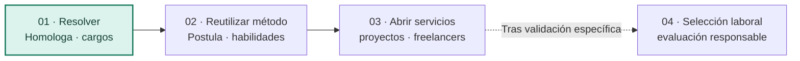

# 03 · Propuesta de valor y escalabilidad

[← General](../README.md) · [Visión completa](04-vision-de-plataforma.md) · [El pitch original](../formativa/02-pitch-y-vision.md) · [Evidencia y costos](../desarrollo/05-evidencia-externa-y-escenarios.md)

## Una solución puntual puede revelar una oportunidad mucho más grande

**Espejo nació cuando vimos que un nombre de cargo no necesariamente describe el trabajo que hay detrás.** Una encuesta salarial puede llamar de un modo a un puesto y una empresa de otro. Si nos guiamos solo por la etiqueta, obtenemos una referencia que parece correcta, pero no representa las funciones reales.

Desarrollamos **Espejo · Homologa** para ordenar esa comparación: **reglas explícitas que filtran, IA opcional que ayuda a interpretar, criterios y razones visibles, y un profesional que decide**. Solo después de determinar la equivalencia entra el benchmark salarial.

La visión de expansión propuesta por Pablo parte de un problema que también aparece en postulaciones y servicios independientes: traducir lo que alguien necesita y lo que otra persona puede demostrar que sabe hacer.

> **Espejo empezó encontrando equivalencias entre cargos. Puede llegar a ayudar a encontrar correspondencias entre capacidades y oportunidades. La decisión sigue siendo humana.**

La ampliación es una propuesta posterior al pitch de la dupla. [Desarrollo de la visión](04-vision-de-plataforma.md).

## Señales del mercado

Las investigaciones de LinkedIn sobre habilidades y la metodología de Buk para estandarizar cargos muestran la importancia de comparar contenido más allá de las etiquetas. Los datos y sus fuentes están en [evidencia externa](../desarrollo/05-evidencia-externa-y-escenarios.md).

La propuesta es ofrecer comparaciones con razones verificables en tareas especializadas. El [estudio de mercado](../desarrollo/07-estudio-de-mercado-y-posicionamiento.md) contrasta esta posibilidad con Buk, Workday, Eightfold y Workana.

## El producto que sí podemos mostrar hoy

| Lo que hace Homologa                                         | Valor que permite defender                                      | Límite                                                                 |
| ------------------------------------------------------------ | --------------------------------------------------------------- | ---------------------------------------------------------------------- |
| Compara cargos por **contenido**, no sueldo                  | Menos dependencia del nombre de un puesto                       | La calidad depende de fichas y criterios                               |
| Expone un motor determinístico reproducible con fichas fijas | Reglas explicables y resultados contrastables                   | Falta completar el historial de parámetros y descartes                 |
| Ofrece una segunda lectura semántica opcional                | Ayuda a comprender similitudes que no caben en un nombre        | La IA puede equivocarse y no decide                                    |
| Permite preseleccionar varios y confirmar uno                | Deja la responsabilidad al profesional y registra su comentario | La decisión puede actualizarse; falta un historial completo de cambios |
| Consulta bandas salariales al final                          | Aporta contexto de mercado después de la homologación           | No determina sueldos ni verifica la calidad de cualquier encuesta      |

El tiempo de uso reportado y el método para medirlo están en [evidencia económica](../desarrollo/05-evidencia-externa-y-escenarios.md).

## Secuencia de expansión propuesta

- **Primero**, una herramienta de compensaciones con un problema, usuarios y entregables claros. Es el núcleo existente.
- **Después**, una experiencia donde la persona pueda identificar vacantes pertinentes, mostrar competencias demostradas y descubrir qué le falta aclarar. La orientación queda bajo el control de la persona.
- **Más adelante**, ayudar a profesionales independientes y clientes a definir mejor proyectos y evaluar entregables comparables, sin sustituir la negociación.
- **Finalmente, si hay evidencia y controles suficientes**, estudiar una herramienta de apoyo a selección. Ese uso requiere medidas de seguridad, equidad, privacidad y revisión mucho más estrictas.

El propósito comercial es transformar conocimientos especializados en servicios con un alcance y un entregable claros.

## Contexto de mercado

Los estudios sobre competencias y trabajo independiente ayudan a identificar problemas y posibles usuarios. La disposición a pagar requiere investigación específica en cada segmento. [Fuentes y escenarios](../desarrollo/05-evidencia-externa-y-escenarios.md) · [Mercado y competencia](../desarrollo/07-estudio-de-mercado-y-posicionamiento.md).

## ¿Dónde podría existir ingreso?

**Dos clientes pueden beneficiarse de la misma idea sin comprar el mismo producto.** Un consultor paga por mejorar su capacidad de entregar homologaciones; una persona postulante quiere orientación; una agencia puede pagar por especificaciones comparables de servicios; un equipo de selección necesitaría un historial verificable. Por eso la **estrategia de venta debe definirse por problema, comprador y entrega**, no solo por el motor.

| Posible oferta                            | Qué recibe quien contrata o usa                                              | Posible modelo (todavía sin ventas)                                                   |
| ----------------------------------------- | ---------------------------------------------------------------------------- | ------------------------------------------------------------------------------------- |
| **Homologa para especialistas**           | Comparaciones revisadas y reportes defendibles                               | Servicio profesional por proyecto, mantenimiento de estudios o licencia especializada |
| **Postula para personas**                 | Brechas explicadas, evidencia y ayuda para preparar mejores candidaturas     | Acceso básico abierto y ayuda profesional opcional, sin vender sus datos              |
| **Servicios para freelancers y clientes** | Claridad de alcance, comparación de entregables y propuestas mejor definidas | Herramienta de propuestas o servicio por solicitud revisada                           |
| **Selección asistida responsable**        | Requisitos claros, revisión humana y documentación de criterios              | B2B solo tras seguridad y validación legal, sin selección automática                  |

Las ofertas son hipótesis comerciales. Su evaluación requiere entrevistas, observación de uso y pruebas de disposición a pagar. [Estrategia de piloto](../desarrollo/06-expansion-y-pilotos.md).

## Dos maneras de escalar que conviene distinguir

**Escala vertical:** hacer más confiable el producto actual: más calidad de homologación, fuentes autorizadas, reportes, consistencia y especialistas capaces de prestar el servicio. El valor proviene de una solución mejor.

**Escala horizontal:** llevar el **procedimiento** de evaluación y explicaciones a otros dominios. El valor proviene de nuevas necesidades, pero requiere **nuevos datos, controles, UI, pruebas y modelos de negocio**, no solo cambiar una etiqueta de la interfaz.

La tercera dimensión es **escala operacional**: varias organizaciones, niveles de tráfico, costos, protección de datos y soporte. Esa capacidad **no está resuelta**. Las funciones usan una clave de servicio de Supabase sin controles generales de autorización por organización; no debe venderse como un SaaS seguro para empresas o CV reales. [Riesgos actuales](../tecnica/07-seguridad-y-limitaciones.md).

[Arquitectura propuesta](../tecnica/08-arquitectura-de-expansion.md).

## La tesis sobre los profesionales

La IA puede acortar tareas mecánicas. **El valor del profesional está en saber qué preguntar, qué comparar, cuándo desconfiar de un resultado, a quién escuchar y qué recomendar con responsabilidad.**

La visión de expansión contempla que las personas puedan combinar empleo, proyectos y servicios propios, mostrando habilidades que no siempre quedan visibles en un título.

**La frase del pitch sigue siendo válida:** «La IA no reemplaza al experto. Potencia su trabajo». La oportunidad adicional —**conectar capacidades con necesidades en otros mercados**— es una visión de expansión que todavía debe construirse y validarse.

[Mercados, competencia y entrada comercial](../desarrollo/07-estudio-de-mercado-y-posicionamiento.md) · [Pitch histórico](../formativa/02-pitch-y-vision.md) · [Modelo económico medible](../desarrollo/04-viabilidad-y-metricas.md) · [Ruta de expansión](../desarrollo/06-expansion-y-pilotos.md).
