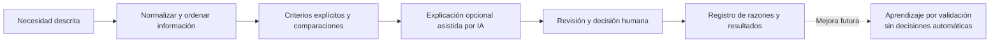

# 04 · Visión de Espejo: del cargo equivalente a la oportunidad adecuada

[← General](../README.md) · [Lo que ya funciona](03-propuesta-de-valor.md) · [Cómo se podría construir](../tecnica/08-arquitectura-de-expansion.md) · [Validar mercados](../desarrollo/06-expansion-y-pilotos.md)

> **Propuesta de evolución de Pablo posterior al pitch de la dupla.** Homologa es el piloto implementado; las demás líneas requieren desarrollo y validación.

## De comparar cargos a relacionar necesidades y capacidades

**Espejo nació comparando cargos. Pero la pregunta que resuelve es mucho más amplia: ¿cómo encontramos una correspondencia defendible entre dos realidades descritas de manera diferente?**

En una encuesta, dos cargos pueden hacer prácticamente lo mismo aunque tengan nombres distintos. En una postulación, una persona puede tener competencias pertinentes sin poseer exactamente el título que aparece en la oferta. En un proyecto freelance, un cliente describe un resultado y un profesional describe los trabajos que sabe entregar: **ambos hablan de la misma necesidad, pero no necesariamente con el mismo lenguaje**.

Nuestro primer paso fue demostrar una manera de trabajar: **estructurar la información, aplicar criterios transparentes, usar IA para interpretar matices y devolver la decisión a una persona**. La oportunidad consiste en llevar ese método a otros encuentros entre **necesidades y capacidades**, sin reducir a nadie a un porcentaje.

**La posible tecnología detrás de la marca es un motor de correspondencias con razones verificables:** una necesidad expresada en términos propios entra al sistema, se normaliza, se contrasta con evidencias y restricciones del dominio, se explican acuerdos y vacíos y una persona decide. El valor transversal sería la **infraestructura para justificar comparaciones**, no un único modelo universal de puntuación ni un marketplace listo para usarse.

**Una misma idea, distintas decisiones humanas.** En el caso actual, decide el analista de compensaciones. En una futura herramienta de postulaciones, decide la persona dónde postularse. En una contratación, una evaluación responsable y documentada corresponde a profesionales autorizados. En servicios independientes, ambas partes conservan la decisión de negociar.

## El precedente que ya construimos

**Lo existente:** los cargos, el motor determinístico por contenido, la IA opcional, la preselección y decisión del analista, el historial y el benchmark salarial posterior. **Lo que se propone escalar:** el procedimiento, reconstruido para nuevos tipos de entidades y decisiones, no el benchmark de sueldos como si fuera universal.

## Cinco líneas de producto

| Posible vertical                                     | Una pregunta que merece respuesta                                                                                     | Experiencia que propondría                                                                                                                    | Quién conserva la decisión                                                        |
| ---------------------------------------------------- | --------------------------------------------------------------------------------------------------------------------- | --------------------------------------------------------------------------------------------------------------------------------------------- | --------------------------------------------------------------------------------- |
| **Homologa · cargos** — **implementado como piloto** | ¿Qué referencia de encuesta se parece más a este cargo por sus funciones?                                             | Comparar puestos, explicar coincidencias y revisar bandas _después_ de homologar                                                              | Analista de compensaciones                                                        |
| **Espejo Postula** — **futuro**                      | ¿A qué vacantes se ajustan mis competencias y qué me falta demostrar?                                                 | Comparar requisitos públicos y experiencias/autoevidencias aportadas por el usuario; explicar fortalezas, brechas y mejoras en su postulación | La persona postulante                                                             |
| **Espejo Talento** — **futuro, mayor riesgo**        | ¿Cómo ayudar a revisar candidatos contra criterios verificables, sin depender únicamente de títulos o palabras clave? | Asistencia para lectura y contraste de requisitos; pruebas y revisión humana; posibilidad de corregir información                             | Equipo de selección autorizado; candidatos con derechos de información y revisión |
| **Espejo Servicios** — **futuro**                    | ¿Qué profesional independiente puede entregar este resultado y bajo qué condiciones?                                  | Confrontar necesidad, entregables, evidencia de experiencia, disponibilidad y alcance; generar preguntas de clarificación                     | Cliente y profesional, mediante acuerdo voluntario                                |
| **Espejo Evoluciona** — **futuro**                   | ¿Qué capacidades puede desarrollar una persona para cambiar de función o asumir nuevos proyectos?                     | Mapa de competencias, evidencia y brechas, rutas de capacitación elegidas por la persona                                                      | Trabajador y responsables de desarrollo profesional                               |

### Ejemplo de postulación: descubrir valor que un título no explica

Una oferta solicita a alguien capaz de generar reportes SQL y desarrollar aplicaciones web. Una persona describe prácticas, proyectos propios y demostraciones de código, pero no aparece la denominación exacta del puesto.

**Lo que hoy suele faltar es una traducción comprensible entre lo que se pide y lo que se puede demostrar.** Una futura Espejo Postula podría ayudarle a identificar coincidencias y vacíos con **evidencia aportada voluntariamente**, sin inventar experiencia o afirmar idoneidad certificada.

El valor comercial es distinto al de RR. HH.: **orientación para postular mejor**, no rechazo de candidatos.

### Ejemplo de servicio freelance: comparar entregables, no personas

Una pequeña empresa necesita un tablero para inventario y ventas. Una persona ofrece «automatizaciones», otra «analítica» y otra «desarrollo web». El nombre del servicio no basta para decidir si harán el trabajo que se necesita.

Una futura Espejo Servicios podría descomponer el proyecto en **entregables, tecnologías, plazo, alcance, evidencia previa y condiciones**. El resultado sería una explicación de correspondencias y preguntas por resolver, **no una orden automática de contratación**. El precio se **negociaría después**; no sería una variable para concluir que un profesional es «mejor» ni para medir su valor como persona.

## Señales de mercado para explorar la visión

Los estudios de LinkedIn sobre búsqueda por competencias, de la OCDE sobre desajuste de habilidades y de la OIT sobre trabajo en plataformas describen problemas relevantes para estas líneas de producto. Los datos, poblaciones y fuentes están reunidos en [evidencia externa](../desarrollo/05-evidencia-externa-y-escenarios.md).

La oportunidad comercial requiere identificar quién necesita cada comparación, qué alternativas utiliza y cuánto valor aporta una explicación revisable. El [estudio de mercado](../desarrollo/07-estudio-de-mercado-y-posicionamiento.md) desarrolla esos segmentos y propone una entrada gradual.

## La posición frente a soluciones que ya existen

El mercado ya cuenta con herramientas para estas tareas: [Buk](https://info.buk.cl/reporte-salarial-buk-2025) homologa cargos con IA; [Workday Skills Cloud](https://doc.workday.com/admin-guide/en-us/human-capital-management/skills-and-skills-cloud/skills-cloud/ilb1557158988004.html) relaciona habilidades con vacantes y movilidad; [Eightfold](https://eightfold.ai/products/) ofrece inteligencia de talento; y [Workana](https://help.workana.com/hc/es/articles/360041829933--C%C3%B3mo-funcionan-los-proyectos-en-Workana) facilita la contratación de servicios.

**El espacio que proponemos explorar:** una herramienta especializada, modular y explicable que haga visibles requisitos, evidencia, divergencias, dudas y responsabilidades. **Todavía debemos probar que esa experiencia resulte mejor** que las alternativas en un flujo concreto y no afirmar ventajas comparativas no medidas. [Competencia, compradores y secuencia de entrada](../desarrollo/07-estudio-de-mercado-y-posicionamiento.md).

## Tres formas distintas de escalar

**1. Profundizar en un sector.** Mejorar homologación: comparación de cargos más reproducible, normalizaciones auditadas, control de encuestas, revisión y resultados medidos. Así se consolida la credibilidad antes de ampliar promesas.

**2. Abrir nuevos problemas mediante módulos.** Conservar la _idea_ de criterios, explicación y juicio humano, y desarrollar **adaptadores específicos** para ofertas, evidencias de habilidades y proyectos. Cada uno necesita vocabulario, pruebas y controles propios. [Arquitectura posible](../tecnica/08-arquitectura-de-expansion.md).

**3. Cambiar el modelo de entrega y negocio.** El mismo conocimiento podría alimentar consultoría por resultados, herramientas de autoevaluación, servicios de reclutamiento responsable o una plataforma de proyectos. **No existe aún un SaaS multiempresa ni un marketplace**; venderlos hoy como disponibles sería incorrecto.

## Presentación de la visión

> **Empezamos resolviendo algo muy específico: decidir a qué cargo de mercado corresponde un puesto real. Descubrimos que el desafío de fondo no era el nombre del puesto; era traducir información, encontrar correspondencias que se puedan explicar y dar al profesional mejores elementos para decidir.**
>
> **Hoy Espejo demuestra ese método en la homologación. Mañana podría ayudar a quienes buscan trabajo a reconocer sus oportunidades, a quienes contratan a entender las capacidades que necesitan y a profesionales independientes a presentar el valor de sus servicios.**
>
> **No pretendemos que la IA decida por las personas: queremos que sus decisiones estén mejor informadas, sean más rápidas cuando corresponda y puedan justificarse.**

La utilidad de cada línea debe comprobarse por calidad, comprensión de las explicaciones, trato justo, costos y aceptación de usuarios.

## El límite que hace creíble la promesa

Aplicar scores a **personas** implica riesgos mayores que comparar **cargos**. Un sistema de contratación puede excluir a alguien injustamente si interpreta mal una experiencia, reproduce sesgos o usa datos no autorizados. Por eso no se propone usar el score de equivalencia salarial directamente para **calificar seres humanos**, tomar decisiones laborales automáticas ni desaconsejar postulaciones por pertenecer a grupos protegidos.

En Europa, herramientas de IA para **clasificar o filtrar postulantes** pueden considerarse sistemas **de alto riesgo** bajo su AI Act ([referencia oficial](https://ai-act-service-desk.ec.europa.eu/en/employment-0)); esto **no se traslada sin más a Chile**. En Chile también deben evaluarse las normas de protección de datos aplicables antes de tratar CV, portafolios, antecedentes personales o postulaciones.

Para llevar esta visión a la práctica se requieren nuevos controles: identidad y autorización, propósito claro, minimización de datos, criterios pertinentes, pruebas de sesgos, explicación accesible, revisión humana significativa, posibilidad de corregir la información y registros auditables. El prototipo actual **no cumple todavía esa preparación para nuevas verticales**.

[Mercado y competencia](../desarrollo/07-estudio-de-mercado-y-posicionamiento.md) · [Prioridades reales](../desarrollo/03-evolucion-y-prioridades.md) · [Estrategia de piloto](../desarrollo/06-expansion-y-pilotos.md) · [Seguridad actual](../tecnica/07-seguridad-y-limitaciones.md).
