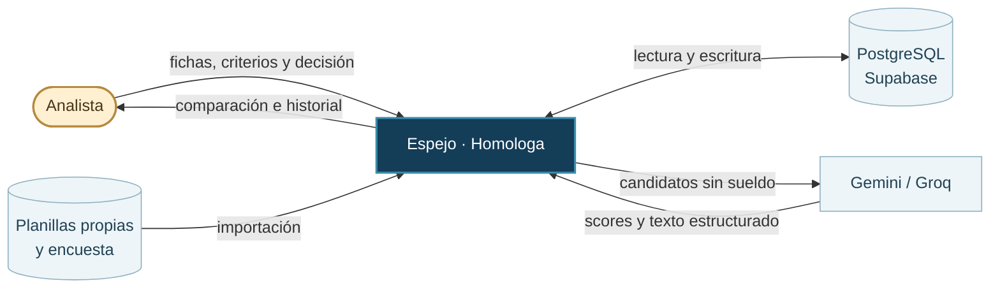
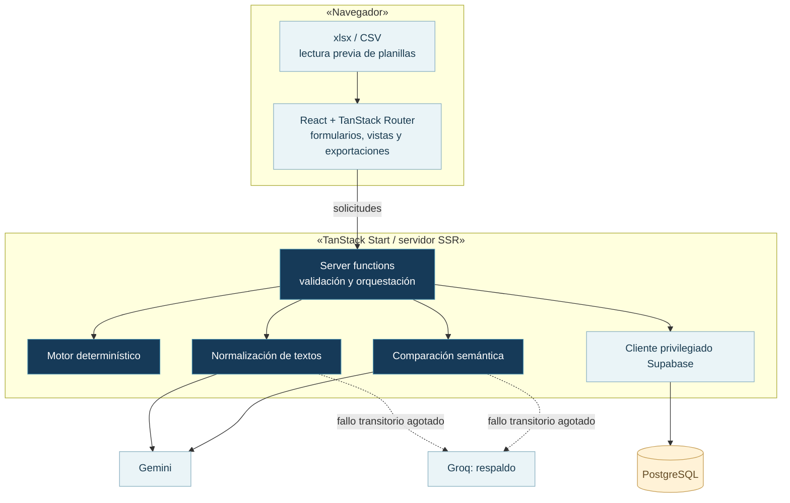
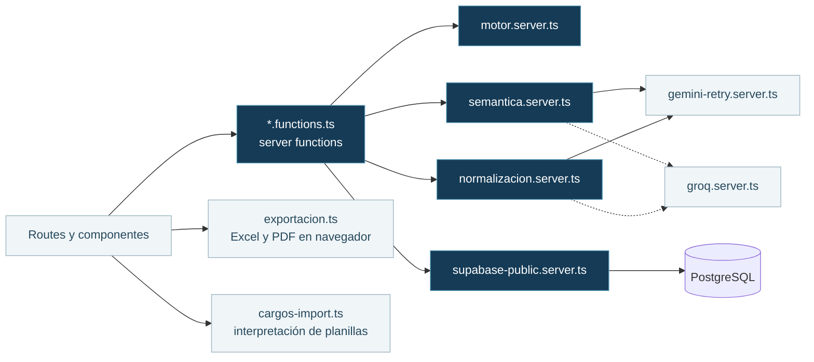
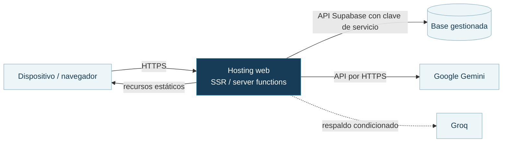

# 01 · Arquitectura

La interfaz se ejecuta en el navegador. Las funciones de servidor consultan la base de datos, ejecutan el motor y se comunican con los proveedores de IA.

## Nivel 1 · Contexto

Las planillas se procesan desde la interfaz. El análisis semántico usa información textual del cargo interno y de los candidatos admitidos; no incorpora sueldo ni tamaño de empresa al payload de comparación.

## Nivel 2 · Contenedores y límites de ejecución

El cliente de base de datos utiliza un rol de servicio que puede omitir RLS. Cada operación necesita validar identidad y permisos antes de usarlo. [Controles de acceso pendientes](07-seguridad-y-limitaciones.md).

## Nivel 3 · Componentes del servidor

| Capa | Referencia del repositorio | Responsabilidad |
| --- | --- | --- |
| Interfaz y navegación | [`src/routes`](../../src/routes) y [`src/components`](../../src/components) | Mostrar pasos, comparar fichas y registrar acciones |
| Funciones del servidor | [`src/lib/homologacion.functions.ts`](../../src/lib/homologacion.functions.ts) y módulos equivalentes | Recibir solicitudes y consultar/actualizar datos |
| Dominio | [`src/lib/motor.server.ts`](../../src/lib/motor.server.ts) | Evaluar criterios sin llamadas de red |
| Normalización/IA | [`normalizacion.server.ts`](../../src/lib/normalizacion.server.ts), [`semantica.server.ts`](../../src/lib/semantica.server.ts) | Preparar fichas y evaluar texto |
| Persistencia | [`supabase-public.server.ts`](../../src/lib/supabase-public.server.ts), [`supabase/migrations`](../../supabase/migrations), [`drizzle/migrations`](../../drizzle/migrations) | Consulta privilegiada y evolución del esquema |
| Informes | [`exportacion.ts`](../../src/lib/exportacion.ts) | Crear Excel y abrir un informe imprimible en el navegador |

## Nivel 4 · Despliegue lógico

Vite y TanStack Start generan la aplicación con una salida compatible con Workers. La plataforma de despliegue debe proporcionar las variables públicas y los secretos de servidor descritos en la [guía de entorno](../desarrollo/01-entorno-y-despliegue.md).

[Dominio y datos](02-dominio-y-datos.md) · [Flujo de secuencia](05-flujos-y-estados.md) · [Despliegue práctico](../desarrollo/01-entorno-y-despliegue.md).
