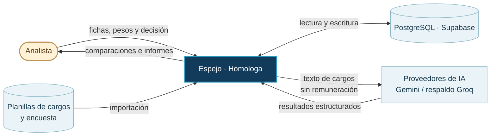
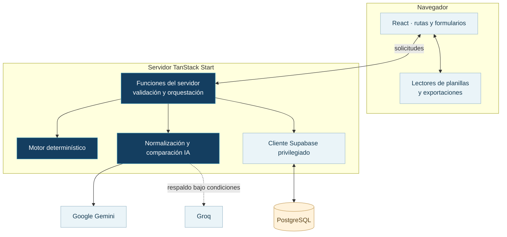
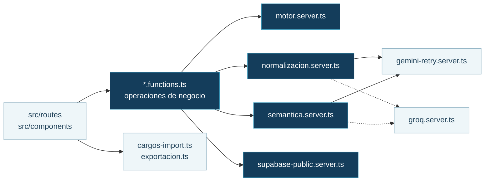
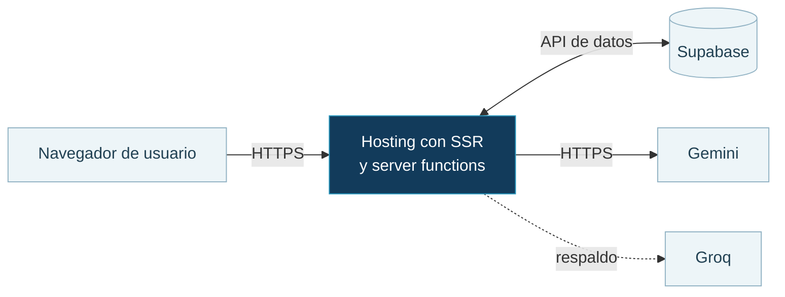

# 01 · Arquitectura, de afuera hacia adentro

La arquitectura separa la **interfaz**, las **operaciones del servidor**, el **cálculo de homologación** y los **servicios externos**.

Esta arquitectura describe el piloto de comparación de cargos. La propuesta para otros dominios está en [arquitectura de expansión](08-arquitectura-de-expansion.md).

## Nivel 1 — Contexto del sistema

La persona decide qué cargo considera equivalente. Las planillas aportan el catálogo y las bandas; los proveedores de IA aportan interpretación textual, no una decisión laboral definitiva.

## Nivel 2 — Contenedores y ubicación de las operaciones

La lectura de planillas y la preparación de informes ocurren en el navegador; las consultas a base y llamadas de IA se hacen a través del servidor. El cliente de base usa `SUPABASE_SERVICE_ROLE_KEY`: esa credencial **no debe salir al navegador**.

## Nivel 3 — Componentes relevantes del repositorio

| Componente                                                                                                                      | Responsabilidad                                                                                    |
| ------------------------------------------------------------------------------------------------------------------------------- | -------------------------------------------------------------------------------------------------- |
| [`src/routes`](../../src/routes) / [`src/components`](../../src/components)                                                     | Navegación, presentación del score, panel del benchmark y decisión.                                |
| [`homologacion.functions.ts`](../../src/lib/homologacion.functions.ts)                                                          | Crear/ejecutar homologación, coordinar IA, preseleccionar, guardar decisión y consultar historial. |
| [`motor.server.ts`](../../src/lib/motor.server.ts)                                                                              | Calcular similitud por campo, pesos y descartes, sin consultas de red.                             |
| [`normalizacion.server.ts`](../../src/lib/normalizacion.server.ts) / [`semantica.server.ts`](../../src/lib/semantica.server.ts) | Estructurar experiencia/formación y evaluar semánticamente candidatos.                             |
| [`supabase-public.server.ts`](../../src/lib/supabase-public.server.ts)                                                          | Acceso a Supabase con credenciales de servidor.                                                    |
| [`cargos-import.ts`](../../src/lib/cargos-import.ts) / [`exportacion.ts`](../../src/lib/exportacion.ts)                         | Interpretar hojas y construir Excel / informe imprimible.                                          |

## Nivel 4 — Despliegue lógico

[`vite.config.ts`](../../vite.config.ts) delega la configuración en `@lovable.dev/vite-tanstack-config`. El despliegue requiere un servidor compatible con TanStack Start y las credenciales de los servicios externos. Consulta [entorno y despliegue](../desarrollo/01-entorno-y-despliegue.md) para preparar la instalación.

El cliente adjunta el token de sesión cuando existe y el servidor configura protección CSRF. La autorización de las operaciones con rol de servicio requiere los controles descritos en [seguridad](07-seguridad-y-limitaciones.md).

[Dominio y datos](02-dominio-y-datos.md) · [Secuencia de operaciones](05-flujos-y-estados.md) · [Desarrollo local](../desarrollo/01-entorno-y-despliegue.md)
