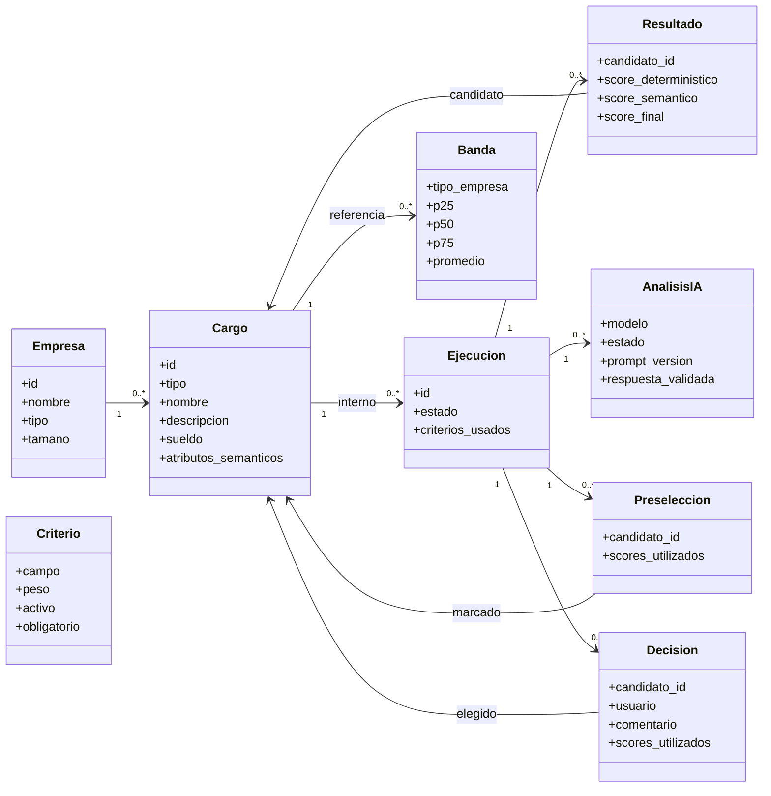
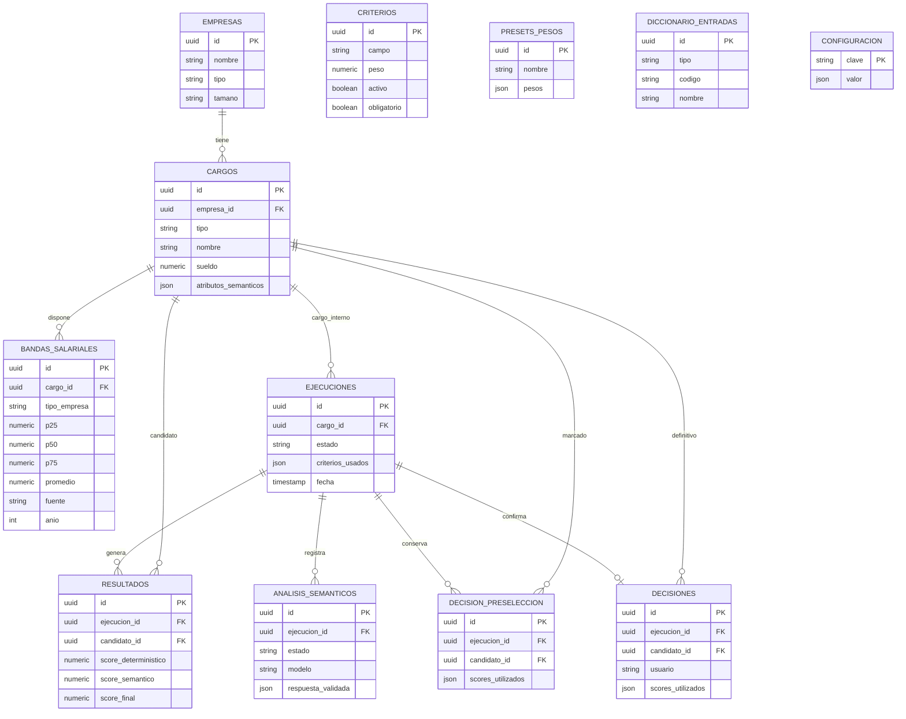

# 02 · Modelo de dominio y base de datos

La base separa **las fichas de cargos**, **los resultados de comparación** y **las decisiones del analista**. Cada ejecución vincula estos registros y conserva los criterios utilizados por el motor.

## Dominio: qué representa cada entidad

**No todos los conceptos son estados.** Un `resultado` indica un candidato admitido por el motor; una `preseleccion` es una marca humana; una `decision` confirma uno. La existencia del primero no implica las otras dos cosas.

## Modelo entidad–relación (persistencia)

Las tablas `CRITERIOS`, `PRESETS_PESOS`, `DICCIONARIO_ENTRADAS` y `CONFIGURACION` actúan como configuración o catálogos; no requieren una relación por clave foránea con las demás tablas para cumplir su función. El diagrama muestra las entidades principales y campos relevantes, no cada columna auxiliar o índice.

## Qué se guarda realmente

| Tabla | Contenido principal | Restricción o matiz |
| --- | --- | --- |
| `empresas` | Nombre, tipo, tamaño | Tamaño opcional para consulta salarial |
| `cargos` | Ficha, tipo interno/referencia, códigos opcionales, sueldo y atributos | El sueldo es informativo y nullable |
| `bandas_salariales` | P25, P50, P75, promedio por tamaño, fuente y año | Único por cargo y tamaño; ausencia ≠ cero |
| `diccionario_entradas` | Código y nombre por área, subárea o nivel | Único por `(tipo, codigo)` |
| `criterios` y `presets_pesos` | Campo, peso, obligatoriedad y ajustes guardados | El campo histórico `tipo_empresa` aún existe en el enum, pero no participa del motor actual |
| `ejecuciones` | Cargo interno, fecha, estado y `criterios_usados` | Almacena la configuración determinística aplicada |
| `resultados` | Candidato, score del motor, IA y final | El score final puede ser `NULL` |
| `analisis_semanticos` | Estado, proveedor/modelo, versión del prompt, salida y errores | Puede haber más de un intento por ejecución |
| `decision_preseleccion` | Conjunto marcado por el analista y copia de scores | Único `(ejecucion_id, candidato_id)` |
| `decisiones` | Una referencia final, analista, comentario y scores utilizados | `ejecucion_id` único; puede reescribirse por `upsert` |
| `configuracion` | Configuración global, incluidos pesos motor/IA | Los pesos son mutables y no se guardan por separado en cada ejecución |

## Esquema y migraciones

El esquema está repartido entre dos series de migraciones: `supabase/migrations/` crea las tablas y los enumerados originales; `drizzle/migrations/` añade bandas, restricciones de acceso, diccionario, decisiones y preselección. Para reconstruir un entorno, hay que revisar el orden de ambas series y las migraciones ya aplicadas. [`drizzle/schema.ts`](../../drizzle/schema.ts) está pendiente de completar.

## Historial y reproducibilidad

Se guardan los criterios determinísticos y las puntuaciones de la decisión. Para reproducir una comparación también haría falta conservar la versión del catálogo, las entradas normalizadas y los pesos híbridos aplicados. El catálogo y las decisiones pueden editarse, y una nueva consulta a la IA puede producir una respuesta distinta.

[Motor](03-motor-deterministico.md) · [Estados](05-flujos-y-estados.md) · [Seguridad](07-seguridad-y-limitaciones.md).
