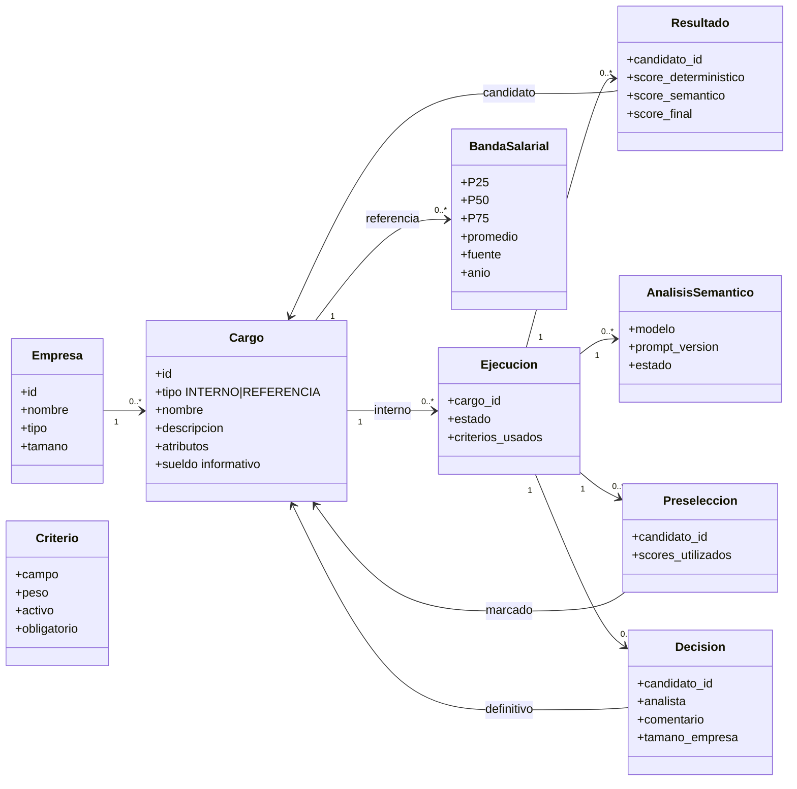
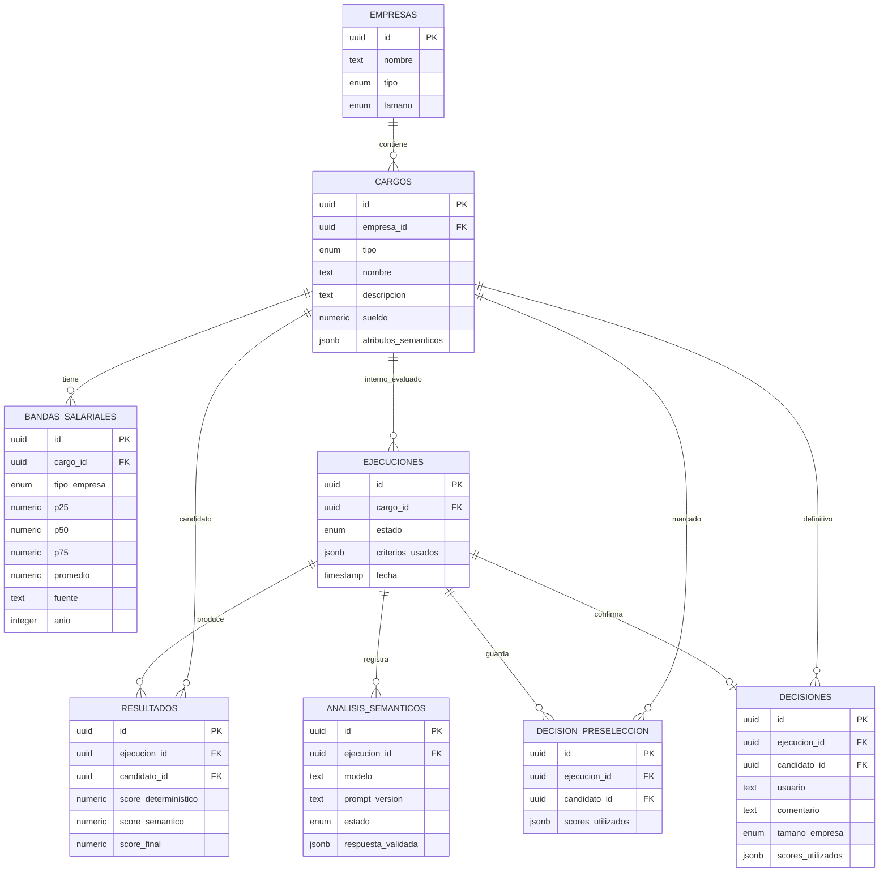

# 02 · Dominio y modelo de persistencia

El dominio distingue **la ficha de un cargo**, **una ejecución que compara cargos**, **los resultados calculados** y **la decisión del analista**. La confirmación de una homologación se registra por separado del cálculo de los puntajes.

## Modelo conceptual (dominio)

Las clases representan conceptos del dominio; su persistencia se detalla en el siguiente modelo de tablas.

## Modelo entidad–relación (tablas)

Este ER está **simplificado para lectura**: se omiten columnas técnicas, índices y tablas sin relaciones FK en este recorrido. Para restricciones exactas deben revisarse las migraciones SQL.

## Tablas que completan el dominio

| Tabla                   | Para qué sirve                                   | Precisión importante                                                                                         |
| ----------------------- | ------------------------------------------------ | ------------------------------------------------------------------------------------------------------------ |
| `criterios`             | Campo, peso, activación y obligatoriedad.        | Los pesos de la ejecución se conservan en `ejecuciones.criterios_usados`.                                    |
| `presets_pesos`         | Conjuntos guardados de ponderaciones.            | No constituyen historial de decisiones.                                                                      |
| `diccionario_entradas`  | Área, subárea y nivel; código/nombre.            | Catálogo auxiliar con unicidad por tipo y código.                                                            |
| `configuracion`         | Guarda opciones globales como `pesos_score`.     | Los pesos globales motor/IA pueden cambiar después de una ejecución.                                         |
| `bandas_salariales`     | Valores de encuesta por cargo y tamaño P/M/G.    | Única combinación `(cargo_id, tipo_empresa)`; valores faltantes admiten `null`.                              |
| `analisis_semanticos`   | Intentos IA, modelo, versión, respuesta y error. | Puede haber varios intentos por ejecución.                                                                   |
| `decision_preseleccion` | Uno o más candidatos elegidos para comparar.     | Unicidad `(ejecucion_id, candidato_id)`.                                                                     |
| `decisiones`            | Referencia definitiva y nombre de analista.      | Restricción **única** por ejecución; la operación actual usa `upsert`, por lo que la fila puede sustituirse. |

## Migraciones del esquema

Las tablas iniciales se definen en [`supabase/migrations`](../../supabase/migrations); las ampliaciones sobre bandas, diccionario, presets, scores híbridos y decisiones están en [`drizzle/migrations`](../../drizzle/migrations). [`drizzle/schema.ts`](../../drizzle/schema.ts) está vacío intencionalmente. Para reconstruir la base hay que revisar las dependencias de ambas carpetas.

## Trazabilidad del cálculo

Se guardan los scores del motor, IA y final, además de una copia de los puntajes usados al decidir. Los pesos globales motor/IA aplicados al cálculo final y los motivos de descarte no se conservan por ejecución. Para reproducir por completo un cálculo histórico hace falta persistir esos datos y la versión de las reglas.

[Motor](03-motor-deterministico.md) · [Flujos y estados](05-flujos-y-estados.md) · [Riesgos](07-seguridad-y-limitaciones.md)
