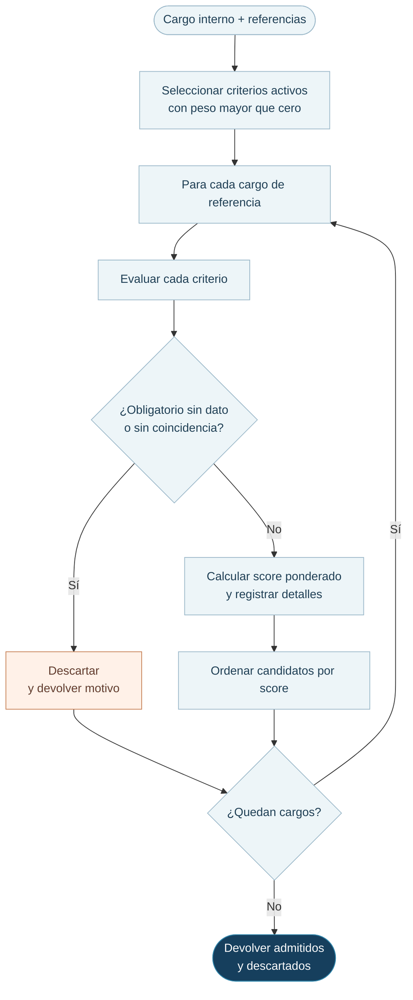

# 03 · El motor determinístico

Con los mismos cargos, criterios y fichas normalizadas, el motor entrega los mismos puntajes y descartes. Su cálculo no realiza llamadas a modelos externos.

**Código:** [`src/lib/motor.server.ts`](../../src/lib/motor.server.ts), llamado desde [`ejecutarHomologacion`](../../src/lib/homologacion.functions.ts).

## Datos que compara

Nombre, descripción, área, subárea, código del cargo, nivel jerárquico, experiencia y requisitos de formación. Para área/subárea se priorizan códigos cuando existen en ambos cargos; de lo contrario se comparan nombres. Experiencia y formación aprovechan fichas normalizadas si están disponibles y usan texto original como alternativa.

**No se compara** salario ni tamaño de empresa. El campo histórico `tipo_empresa` sigue declarado en la base, pero las funciones actuales lo excluyen de los criterios operativos.

## Regla de cálculo

Para cada criterio activo de peso positivo, el motor obtiene un valor entre 0 y 1. El score es:

$$
S_{motor}=\frac{\sum_{i\in A}w_i\,s_i}{\sum_{i\in A}w_i}
$$

Donde `A` reúne los criterios activos con peso positivo. Un dato ausente devuelve `null` en su comparación: **no suma al numerador, pero el peso continúa en el denominador**. Por ello penaliza la falta de información. Un criterio marcado obligatorio descarta al candidato si el dato falta o el puntaje calculado es cero.

Los textos se preparan sin tildes ni símbolos y se comparan por términos. La similitud del nombre y la descripción usa la proporción de términos del **cargo interno** que aparecen en el candidato, por lo que no es simétrica. La formación considera niveles y conjuntos de áreas o carreras; la experiencia, rangos de años y áreas.

## Secuencia de evaluación

### Ejemplo de cálculo

Con un peso de 60 % para funciones/descripción y una similitud de 0,8, más un peso de 40 % para nivel jerárquico y una similitud de 1, el resultado es `0,6 × 0,8 + 0,4 × 1 = 0,88`, es decir, 88 %.

## Interpretación de los resultados

- Un score elevado no confirma equivalencia: **sólo ordena** los candidatos que cumplen los requisitos obligatorios.
- Un dato ausente conserva el peso del criterio en el denominador y no suma al numerador.
- Un criterio con peso 0 % queda fuera del cálculo. Si no hay pesos positivos, la interfaz/función de servidor exige corregir la configuración antes de ejecutar.
- La normalización con IA es una etapa previa y sus resultados pueden variar si la ficha cambia o se recalcula. El motor es determinístico **una vez fijadas esas entradas**.
- Los motivos de descarte se devuelven al cliente durante la ejecución, pero la tabla `resultados` guarda los admitidos; **no hay una tabla dedicada al historial completo de descartes**.

[Normalización e IA](04-ia-y-normalizacion.md) · [Dominio y datos](02-dominio-y-datos.md).
