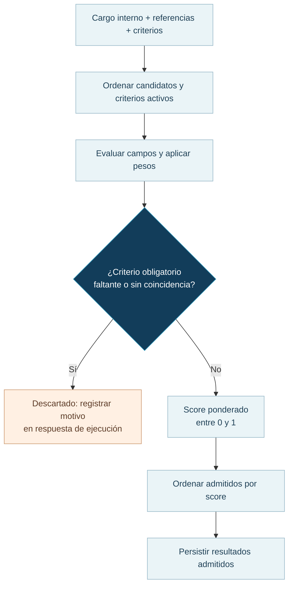

# 03 · El motor determinístico

[`motor.server.ts`](../../src/lib/motor.server.ts) recibe una ficha interna, un conjunto de referencias y los criterios activos; devuelve scores, coincidencias, diferencias y descartes. El cálculo utiliza el contenido y la estructura de los cargos, sin consultar remuneraciones ni servicios externos.

## Cómo se forma el score

Para cada criterio activo con peso mayor que cero se evalúa un valor entre **0 y 1**. El score del candidato admitido es una suma ponderada dividida por el total de pesos activos:

$$
S_{motor}=\frac{\sum_{i\in C} w_i\,s_i}{\sum_{i\in C}w_i}
$$

Aquí `C` incluye criterios activos con peso positivo. Un dato que falta da `null` en la comparación y aporta **0 al acumulado**, sin eliminar su peso del denominador. Si ese criterio es **obligatorio**, el candidato se descarta por ausencia de dato o coincidencia igual a cero. Si no existen pesos positivos, la función de servidor rechaza ejecutar.

## Reglas por tipo de dato

| Campo                | Método                                                                                                                         |
| -------------------- | ------------------------------------------------------------------------------------------------------------------------------ |
| Nombre y descripción | Coincidencia de términos normalizados con relación a los términos del cargo interno; no es una comparación semántica profunda. |
| Área y subárea       | Igualdad de códigos si ambos existen; en caso contrario, comparación textual de nombres.                                       |
| Código de cargo      | Igualdad normalizada de código.                                                                                                |
| Nivel jerárquico     | Código igual, o comparación textual cuando hay valor.                                                                          |
| Experiencia          | Traslape de años y similitud Jaccard de áreas normalizadas; si faltan fichas utilizables, texto original.                      |
| Formación            | Comparación de nivel, áreas y carreras normalizadas; si faltan fichas utilizables, texto original.                             |

La similitud de nombre y descripción es **direccional**: mide coincidencias sobre los términos del cargo interno, no una distancia simétrica entre fichas. Conviene saberlo antes de interpretar un 80 % como «equivalencia de 80 %». En experiencia y formación, la normalización previa puede usar un modelo de IA, pero una vez fijadas las fichas **el cálculo del motor es reproducible**.

## Flujo de evaluación

Por ejemplo, con dos criterios de pesos 60 y 40, valores de similitud 0,8 y 1, el score sería `(60 × 0,8 + 40 × 1) / 100 = 0,88`.

## Qué ocurre al terminar

`ejecutarHomologacion` guarda en `ejecuciones.criterios_usados` el conjunto de criterios empleado y crea filas en `resultados` para los candidatos admitidos. Los descartes se muestran durante esa ejecución, **pero sus motivos no quedan persistidos como tabla de descarte histórica**. La ejecución pasa a `COMPLETADA` si el motor y sus escrituras terminan, con independencia de que después se solicite IA o se registre una decisión.

[Datos](02-dominio-y-datos.md) · [IA y score final](04-ia-y-normalizacion.md) · [Estados](05-flujos-y-estados.md)
