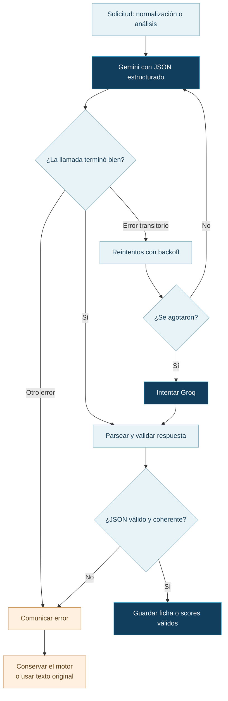

# 04 · Dos usos de IA dentro del producto

El servidor utiliza IA para **normalizar información de las fichas** y **comparar semánticamente los candidatos admitidos por el motor**. Sus resultados apoyan la decisión del analista.

## A. Normalización previa de experiencia y formación

[`normalizacion.server.ts`](../../src/lib/normalizacion.server.ts) convierte los textos originales en campos estructurados: rangos de años, áreas de experiencia, nivel de formación, áreas y carreras. La ficha se conserva dentro de `cargos.atributos_semanticos._norm`, junto con `norm-1` y una huella del texto. Cuando la huella sigue vigente se puede reutilizar sin una nueva llamada.

La instrucción exige no inventar datos: lo ausente vuelve como `null` o listas vacías. Si el servicio no responde, el motor continúa comparando el texto original. **El resultado puede cambiar** respecto de la ruta con ficha normalizada, aunque el sistema no interrumpa la ejecución.

## B. Análisis semántico de candidatos

[`semantica.server.ts`](../../src/lib/semantica.server.ts) recibe el cargo interno y **únicamente los candidatos que admitió el motor**. En el payload entran nombre, descripción, siete atributos de contenido (propósito, funciones, responsabilidades, conocimientos, complejidad, autonomía y alcance), experiencia y formación. **No entra remuneración, tamaño de empresa, catálogo completo, descartes ni pesos del motor.**

La respuesta se valida con IDs enviados, ausencia de duplicados, cobertura de todos los candidatos y rangos numéricos. Incluye score por candidato (0–100), confianza (0–1), explicación breve y una recomendación de referencia. Esa recomendación es informativa; la decisión humana se guarda por otro camino.

## Resiliencia frente a fallos del proveedor

El **respaldo con Groq no es universal**: se activa cuando se agotan errores transitorios reconocidos en Gemini. Falta de clave, respuesta malformada o un error no transitorio no garantizan esa alternativa. La disponibilidad del modelo indicado por `GEMINI_MODEL` y de las cuotas debe comprobarse en cada entorno.

## Tres scores, dos escalas

| Campo persistido       | Escala | Origen                                                        |
| ---------------------- | ------ | ------------------------------------------------------------- |
| `score_deterministico` | 0–1    | Reglas y pesos del motor.                                     |
| `score_semantico`      | 0–100  | Comparación semántica validada.                               |
| `score_final`          | 0–1    | Combinación ponderada **si hay** datos de ambas evaluaciones. |

El reparto predeterminado está en [`configuracion.functions.ts`](../../src/lib/configuracion.functions.ts): **70 % motor y 30 % IA**, configurable globalmente. Si los pesos son porcentajes que suman 100:

$$
S_{final}=\frac{p_{motor}S_{motor}+p_{IA}(S_{semantico}/100)}{100}
$$

Cuando la IA no devuelve una evaluación válida, `score_semantico` y `score_final` pueden permanecer **`null`**. No corresponde convertirlos en cero. El score final calculado queda guardado, **pero el reparto global leído en esa ocasión no se conserva como snapshot autónomo por ejecución**; por eso no se garantiza su reproducción histórica exacta después de modificar la configuración.

[Motor](03-motor-deterministico.md) · [Flujos](05-flujos-y-estados.md) · [Validación](../desarrollo/02-validacion-y-mantenimiento.md)
