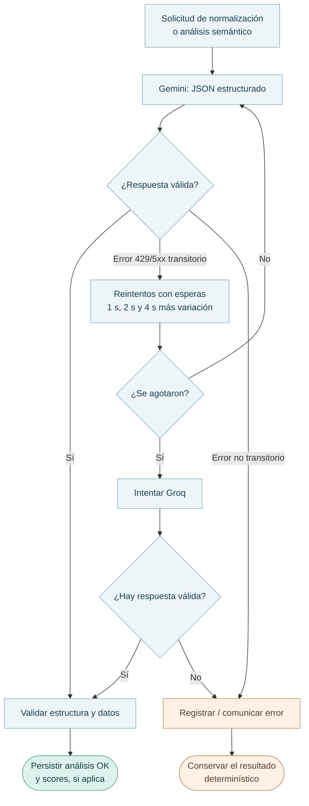

# 04 · IA y normalización

La aplicación usa IA en dos etapas: normalizar los requisitos de los cargos y comparar semánticamente los candidatos admitidos por el motor. La referencia definitiva la confirma el analista.

## A. Normalizar experiencia y formación

[`normalizacion.server.ts`](../../src/lib/normalizacion.server.ts) transforma textos libres en una ficha estructurada: rangos de años, áreas de experiencia, nivel, áreas y carreras de formación. Guarda la ficha en `cargos.atributos_semanticos._norm`, junto con `norm-1` y una huella del texto original. Si la huella coincide, puede reutilizarla sin volver a consultar al proveedor.

La normalización debe conservar los datos ausentes. Si falla, la homologación continúa con el texto original y muestra un aviso; los puntajes pueden diferir de los obtenidos con una ficha normalizada.

## B. Analizar la equivalencia semántica

[`semantica.server.ts`](../../src/lib/semantica.server.ts) toma únicamente el cargo interno y los **candidatos admitidos por el motor**, con nombre, descripción, siete atributos descriptivos y requisitos de experiencia/formación. Evalúa propósito, funciones, responsabilidades, conocimientos, complejidad, autonomía, alcance, experiencia y formación.

No envía sueldo ni tamaño de empresa; tampoco envía los descartados, los pesos ni el catálogo completo. La respuesta tiene scores semánticos de 0 a 100 por candidato y una explicación breve, validada frente a los identificadores enviados.

## C. Reintentos y respaldo

El respaldo Groq se activa cuando Gemini agota los reintentos ante errores transitorios reconocidos. Los errores de formato JSON y otros fallos no transitorios se comunican sin activar automáticamente el respaldo. Los modelos se configuran mediante las variables del entorno y `groq.server.ts`; su uso depende de la cuota y disponibilidad del proveedor.

## D. Tres puntajes, dos escalas

| Dato | Escala persistida | Cuándo existe |
| --- | --- | --- |
| `score_deterministico` | 0 a 1 | Si el candidato pasó el motor |
| `score_semantico` | 0 a 100 | Cuando la respuesta de IA válida incluye al candidato |
| `score_final` | 0 a 1 | Cuando existen ambos y se aplica el reparto global de pesos |

Por defecto el reparto es **70 % motor / 30 % IA**, configurable en `configuracion.pesos_score`.

$$
S_{final}=\frac{p_m\, S_{motor}+p_{ia}\,(S_{IA}/100)}{100},\qquad p_m+p_{ia}=100
$$

El resultado numérico se guarda, pero los pesos híbridos aplicados no se conservan por ejecución. Versionarlos es una de las [mejoras pendientes](../desarrollo/03-evolucion-y-prioridades.md) para reproducir cálculos históricos.

[Motor](03-motor-deterministico.md) · [Estados](05-flujos-y-estados.md) · [Prioridades](../desarrollo/03-evolucion-y-prioridades.md).
