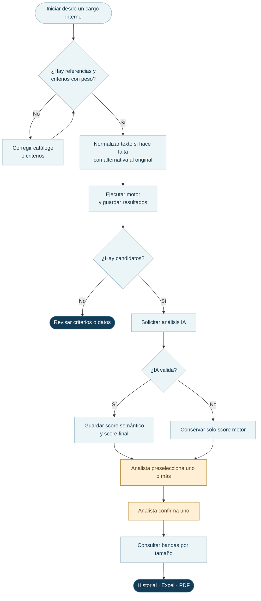
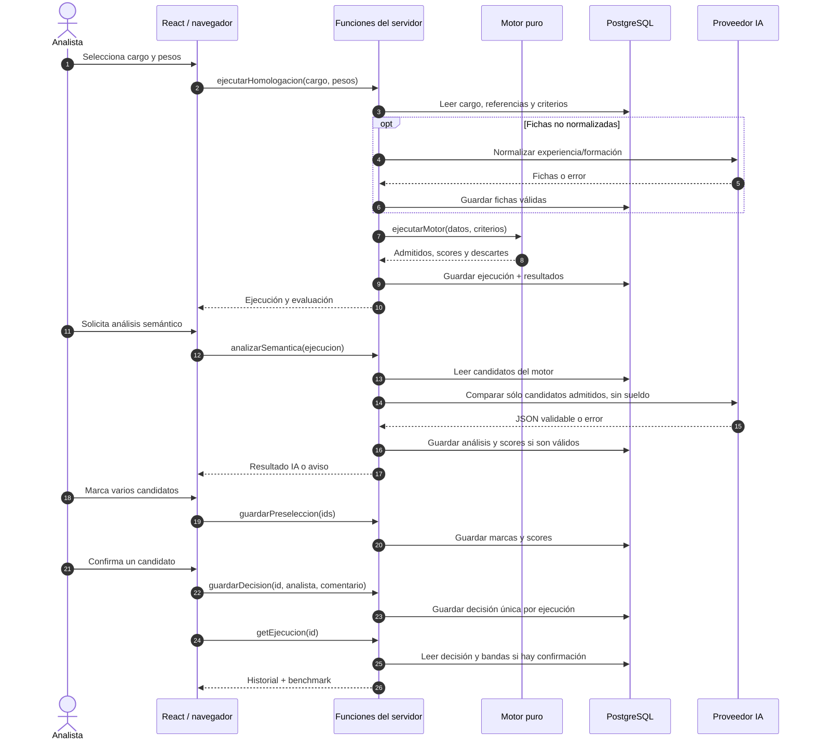
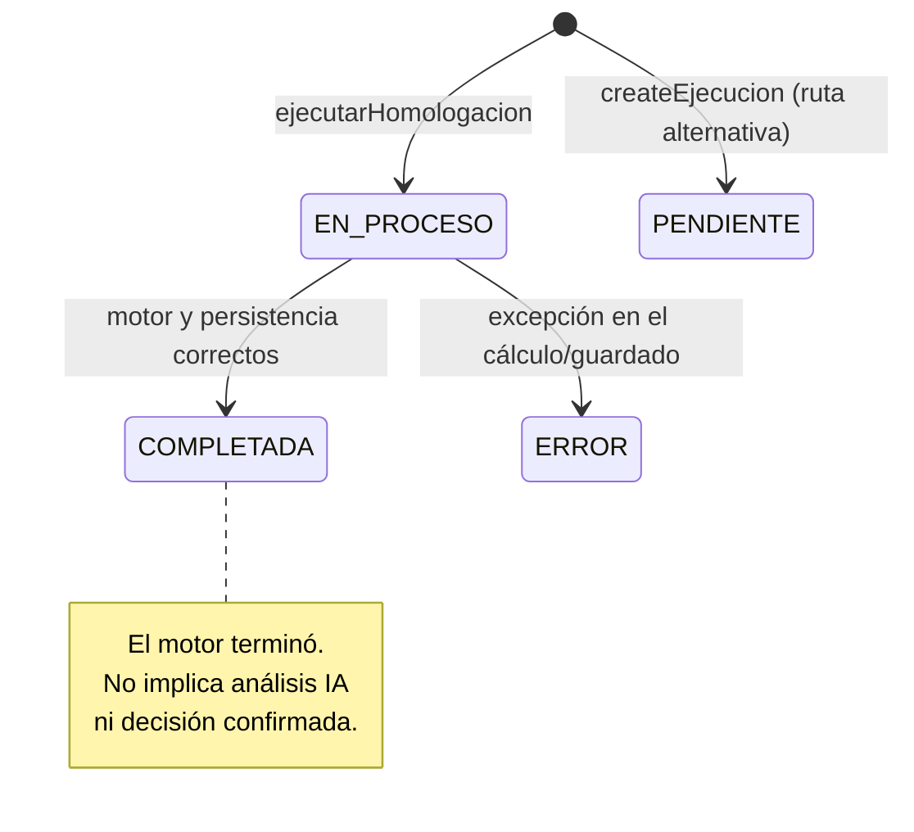
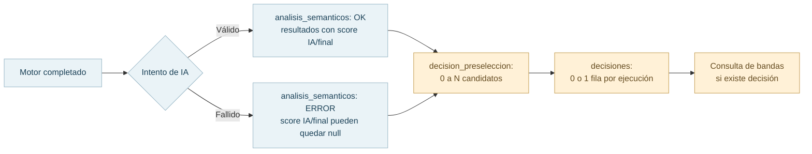

# 05 · Flujos, secuencia y estados

Los pasos de la interfaz y los estados guardados en la base se gestionan por separado. Retroceder en el asistente no revierte una ejecución ya guardada.

## Actividad completa de homologación

El análisis de IA es asistencial: una falla no elimina candidatos determinísticos. La decisión final la registra el analista; el backend no obliga a un score semántico presente.

## Secuencia de componentes

La preselección se guarda mediante varias consultas. Un fallo intermedio o solicitudes concurrentes pueden dejar cambios parciales; la actualización atómica está pendiente.

## Máquina de estados de ejecución (persistida)

El esquema define `PENDIENTE`, `EN_PROCESO`, `COMPLETADA` y `ERROR`. `createEjecucion` crea una ejecución `PENDIENTE`; el flujo principal, `ejecutarHomologacion`, crea una nueva directamente como `EN_PROCESO`.

## Estados de análisis y decisión (persistencias distintas)

El análisis, la preselección y la decisión se guardan en tablas separadas. El `upsert` de `decisiones` permite actualizar la referencia confirmada para un mismo `ejecucion_id`.

[Guía general](../general/02-recorrido-del-analista.md) · [ER](02-dominio-y-datos.md) · [Seguridad](07-seguridad-y-limitaciones.md).
