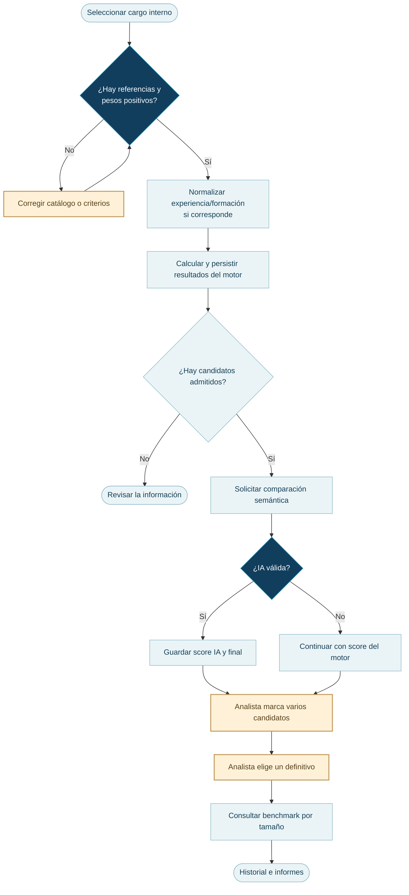
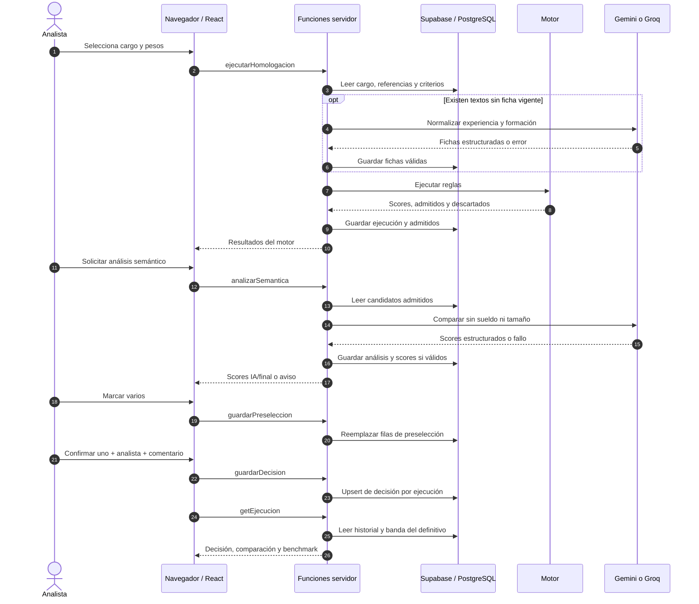
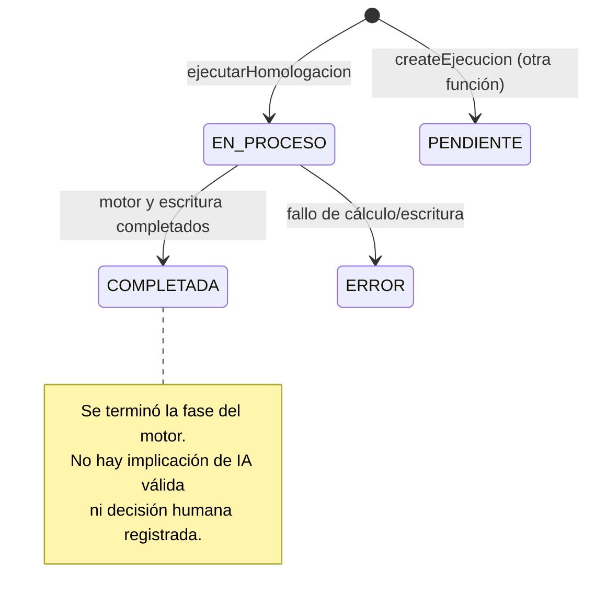
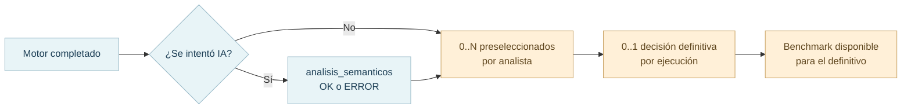

# 05 · Flujos, secuencia y estados

Para interpretar el historial hay que distinguir **lo que sucede en la pantalla** de **lo que se guarda en tablas distintas**. Una ejecución que terminó de calcular no implica que la IA haya funcionado ni que alguien haya confirmado un cargo.

## Actividad de una homologación

La etapa de IA no debe leerse como requisito para registrar una decisión. Si el análisis falla, el motor se conserva y el analista puede continuar. La preselección de esta etapa es **humana**, distinta de la lista que el motor llamó internamente `preseleccionados`.

## Secuencia — Quién llama a quién

**El diagrama muestra operaciones lógicas, no una transacción ACID única.** `guardarPreseleccion` elimina las marcas anteriores e inserta las nuevas mediante consultas separadas. Ante errores intermedios o concurrencia, la aplicación necesita protección o recuperación adicional.

## Estados persistidos de la ejecución

El enum de base incluye `PENDIENTE`, `EN_PROCESO`, `COMPLETADA` y `ERROR`. El flujo principal crea directamente una ejecución `EN_PROCESO`. `createEjecucion` crea una fila `PENDIENTE`, sin una transición automática hacia la ejecución del motor.

## Resultado de IA y elección humana: no son el mismo estado

`analisis_semanticos` guarda intentos `OK` o `ERROR`; `decision_preseleccion` guarda de cero a muchos marcados y `decisiones` permite como máximo una fila por ejecución. El servidor usa `upsert` en esa última tabla, de modo que **«única» no significa «inmutable»**. El estado del motor y la decisión del analista se interpretan por separado.

[Recorrido general](../general/02-recorrido-del-analista.md) · [Modelo de datos](02-dominio-y-datos.md) · [Seguridad](07-seguridad-y-limitaciones.md)
