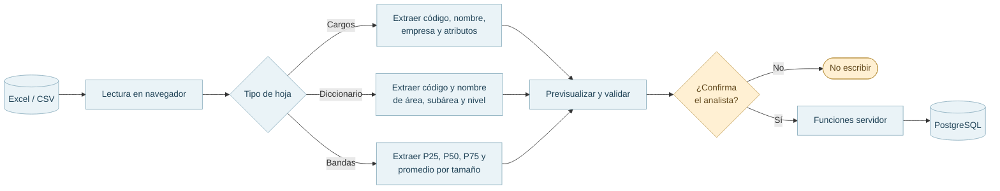

# 06 · Importación, benchmark y exportación

Las planillas se leen en el navegador y sus datos se revisan antes de guardarlos. Los informes se construyen a partir de la ejecución y la decisión registradas.

## Entradas de planillas

[`cargos-import.ts`](../../src/lib/cargos-import.ts) incluye lectores para cargos, diccionario y bandas; [`cargos.functions.ts`](../../src/lib/cargos.functions.ts) y funciones relacionadas gestionan la persistencia. El proceso admite carga de datos de empresa y catálogo de referencia mediante la interfaz.

El lector de cargos reconoce variantes de encabezados, exige código y nombre y marca códigos duplicados dentro del archivo. El lector salarial requiere encabezados agrupados por tamaño (pequeña, mediana o grande) y los símbolos `P25`, `P50`, `P75` o `PP`. Los códigos y nombres originales se conservan al interpretar los campos.

## Bandas y remuneración

La tabla `bandas_salariales` almacena P25, P50, P75 y promedio para cada cargo de referencia y tamaño de empresa, además de `fuente` y `anio` cuando se proporcionan. Una banda ausente no se interpola ni se traduce en cero.

La **remuneración interna** está disponible como información de contexto y para calcular brechas contra la encuesta. En la pantalla de decisión se ven bandas salariales de los candidatos preseleccionados antes de confirmar el definitivo; después de confirmar, **los gráficos del benchmark web y del informe PDF** muestran únicamente los cuatro valores de encuesta, mientras las tablas de comparación mantienen la remuneración interna y las brechas. No es una serie estadística de la encuesta ni interviene en el puntaje de homologación. La brecha se interpreta como `remuneración interna − valor de encuesta`; si falta alguno de los datos o el denominador es cero, no se calcula el porcentaje.

## Exportaciones existentes

En el detalle del historial, **después de confirmar una decisión**, se construyen los datos del informe sin llamar nuevamente a IA. [`exportacion.ts`](../../src/lib/exportacion.ts) implementa dos salidas:

- **Excel (`xlsx`)**: libro con candidatos y scores, comparación salarial y contexto de la decisión. Parte de la preselección humana guardada; en ejecuciones antiguas sin preselección, utiliza el definitivo.
- **PDF imprimible**: abre una vista HTML para imprimir o guardar como PDF desde el navegador. Su gráfico muestra **P25, P50, P75 y promedio de la encuesta**, igual que el panel web. La remuneración interna aparece en la tabla de comparación y brechas. El navegador debe permitir la ventana emergente del informe.

[Ciclo completo](05-flujos-y-estados.md) · [Datos](02-dominio-y-datos.md).
