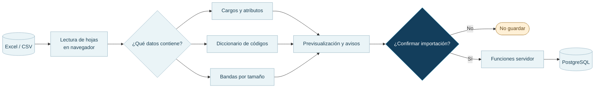

# 06 · Planillas, benchmark e informes

La información de cargos y de encuesta llega principalmente en archivos. Por eso conviene explicar qué reconoce la aplicación, qué conserva y qué **no debe completar por su cuenta**.

## Importación — del archivo a la base

[`cargos-import.ts`](../../src/lib/cargos-import.ts) reconoce variantes concretas de encabezados para cargos (por ejemplo, código y nombre), marca códigos duplicados dentro de la hoja y puede utilizar un diccionario de área, subárea y nivel. No es un lector universal de Excel: **si el archivo no sigue las estructuras esperadas habrá que adaptarlo o corregir la planilla**. Las bandas se leen de encabezados agrupados por empresa pequeña, mediana y grande, con `P25`, `P50`, `P75` y `PP` como promedio.

La base registra además fuente y año de bandas si se entregan: el sistema no debe inventarlos. Los valores faltantes quedan ausentes, no se rellenan con cero.

## Remuneración: qué se compara y qué no

`cargos.sueldo` pertenece al contexto del cargo interno. `bandas_salariales` pertenece al catálogo de referencia y almacena **P25, P50, P75 y promedio**, separados por tamaño `P`, `M` o `G`, con fuente y año cuando existen.

La regla acordada para los gráficos es muy específica: **solo se grafican los cuatro valores de encuesta** tanto en el panel web como en el informe imprimible. La remuneración interna se muestra en fichas y tablas de brechas, no como una barra adicional. La diferencia es:

$$
\text{brecha absoluta}=\text{remuneración interna}-\text{valor de encuesta}
$$

Si falta un valor o el de encuesta es cero, no se calcula el porcentaje de brecha. Ninguno de estos montos participa en el motor o la llamada semántica.

## Salidas desde el historial

| Salida    | Archivo responsable                                      | Qué genera                                                                                             |
| --------- | -------------------------------------------------------- | ------------------------------------------------------------------------------------------------------ |
| **Excel** | [`src/lib/exportacion.ts`](../../src/lib/exportacion.ts) | Hojas de resumen, candidatos/scores y comparación salarial, con información de la decisión registrada. |
| **PDF**   | `abrirInformePdf` del mismo archivo                      | Abre un documento HTML imprimible en otra ventana para guardar como PDF con el navegador.              |

Los candidatos incluidos en los informes se toman de la preselección guardada; en ejecuciones anteriores sin esa lista, la interfaz contempla utilizar el definitivo. Los informes **leen información persistida** y no vuelven a ejecutar IA. La vista PDF necesita que el navegador permita la apertura de la ventana.

Las cifras y las bandas se consultan desde el catálogo vigente. El historial no conserva una copia de las bandas del momento de la ejecución.

[Recorrido](../general/02-recorrido-del-analista.md) · [Modelo de datos](02-dominio-y-datos.md) · [Validación](../desarrollo/02-validacion-y-mantenimiento.md)
