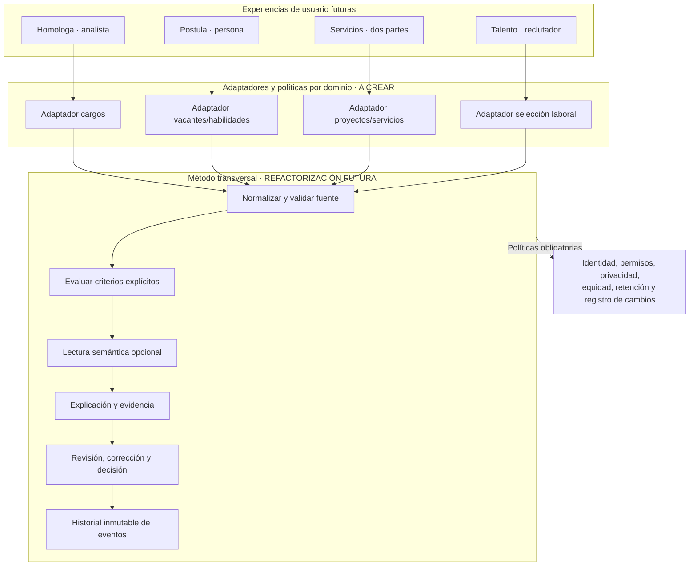

# 08 · Evolución técnica: correspondencias explicables por dominio

[← Técnica](../README.md) · [Motor actual](03-motor-deterministico.md) · [Visión de expansión](../general/04-vision-de-plataforma.md) · [Seguridad](07-seguridad-y-limitaciones.md)

> **Arquitectura propuesta.** La implementación actual está especializada en cargos, con `CargoMotor`, `CriterioCampo` y las tablas de homologación. Los adaptadores descritos aquí requieren desarrollo.

## Lo que sí es reutilizable: un método, no todo el código

La implementación actual ya separa varias responsabilidades útiles:

| Pieza existente        | Evidencia                                                                                                 | Cómo podría reutilizarse                                     | Qué **no** se puede trasladar sin cambios                                                                  |
| ---------------------- | --------------------------------------------------------------------------------------------------------- | ------------------------------------------------------------ | ---------------------------------------------------------------------------------------------------------- |
| **Reglas y criterios** | `src/lib/motor.server.ts`: comparación pura, criterios activos/obligatorios, pesos y descartes            | Explicar qué atributos se consideran y por qué               | `CriterioCampo` admite ocho campos de cargo; no sabe de portfolios, entregables ni personas                |
| **Normalización**      | `normalizacion.server.ts`: experiencia/formación estructurada y versionada, con texto original conservado | Comparar expresiones distintas con campos entendibles        | Su modelo de experiencia/formación no verifica títulos, certificaciones ni proyectos                       |
| **IA semántica**       | `semantica.server.ts`: prompt `semantic-1`, lista cerrada de candidatos y validación estructurada         | Segunda lectura explicativa restringida a datos entregados   | El prompt dice **«cargos»** y evalúa propósito/responsabilidades; no es un clasificador de personas        |
| **Gobernanza humana**  | `homologacion.functions.ts`: preselección de varios, decisión con analista y comentario                   | Diferenciar recomendación de decisión y registrar revisiones | **Una decisión final por ejecución** no representa selección de múltiples personas o negociación bilateral |
| **Benchmark**          | Tablas y panel de bandas P25/P50/P75/promedio                                                             | Producto vertical para compensaciones                        | No es componente genérico ni se puede utilizar como estimador automático de precio de un freelancer        |
| **Persistencia**       | `cargos`, `ejecuciones`, `resultados`, `decisiones` y relaciones                                          | Inspirar un historial de decisiones y justificaciones        | Esquema relacional actual está acoplado a cargos, no a perfiles, solicitudes o contratos                   |

El flujo genérico **no** debe inferir que una persona tiene competencias por su cargo anterior, edad, origen, universidad o estilo de escritura. Para seleccionar personas se necesita **evidencia, contexto y un derecho a revisión**, no analogías automáticas con un score salarial.

## La pieza nueva que cada dominio necesitaría

Para que la visión comercial tenga una base técnica, se propone definir **un contrato de correspondencia explicable** antes de introducir nuevos verticales: (1) unidad de necesidad y sus requisitos; (2) unidad de evidencia consentida o autorizada; (3) restricciones obligatorias y excepciones; (4) reglas y fuentes versionadas; (5) explicación de coincidencias, faltantes y motivos de abstención; y (6) un proceso de revisión y corrección específico.

En lugar de usar una sola lista de ocho `CriterioCampo` para todo, una futura interfaz separaría **normalización**, **generación acotada de referencias**, **evaluación por dominio**, **explicación vinculada a evidencia** y **acto de decisión**. Habilidades y ocupaciones podrían mapearse a vocabularios como [ESCO](https://esco.ec.europa.eu/es/about-esco/what-esco) como referencia exploratoria; la adaptación regional, las licencias y la actualización de términos seguirían siendo trabajos propios.

**Guardarraíl central:** en postulaciones y reclutamiento, una ausencia de evidencia es «información no acreditada», no prueba de incapacidad. No se infieren competencias de proxies personales. Una búsqueda que amplía oportunidades tampoco equivale a una autorización para descartar personas.

## Arquitectura objetivo de módulos, paso a paso



El bloque central representa la refactorización futura. La implementación actual conserva sus funciones y flujos específicos de cargos.

## Una correspondencia no es lo mismo en cada mercado

| Pregunta de diseño   | Homologa **actual**                                | Postula **futura**                                                   | Servicios **futuros**                                | Talento **futuro**                                                        |
| -------------------- | -------------------------------------------------- | -------------------------------------------------------------------- | ---------------------------------------------------- | ------------------------------------------------------------------------- |
| **Objeto de origen** | Cargo interno                                      | Competencias/evidencias declaradas por la persona                    | Necesidad y entregables del cliente                  | Requisitos verificables de la vacante                                     |
| **Referencias**      | Cargos de encuesta                                 | Vacantes accesibles y autorizadas                                    | Portafolios, ofertas de servicio y condiciones       | Postulaciones autorizadas y material de evaluación                        |
| **Comparabilidad**   | Funciones, área, jerarquía, experiencia, formación | Habilidades demostradas, requisitos expresos, brechas de información | Alcance, entregables, plazos, experiencia demostrada | Criterios laborales pertinentes y evaluación estructurada                 |
| **Qué evitar**       | Sueldo en similitud                                | Inferir competencia por prestigio de un título                       | Confundir precio con calidad o identidad personal    | Características protegidas, proxies discriminatorios, descarte automático |
| **Decisor**          | Analista                                           | La persona postulante                                                | Cliente y profesional (acuerdo bilateral)            | Personas responsables con revisión significativa                          |
| **Salida**           | Referencia elegida y benchmark posterior           | Opciones y preguntas para reforzar la candidatura                    | Encaje preliminar y puntos por negociar              | Apoyo a evaluación explicable, **no adjudicación automática**             |
| **Acreditación**     | Versión de criterios y fuente salarial             | Procedencia de habilidades y voluntad de compartir                   | Evidencia de proyectos y términos aceptados          | Permisos, revisión, mecanismo de reclamo y pruebas de sesgo               |

### Un contrato de diseño, no una API que exista

Las futuras verticales podrían ofrecer un contrato conceptual:

```text
EntradaComparable:
  tipo_de_problema
  origen_consentido
  referencias_permitidas
  criterios_versionados
  evidencia_por_atributo
  restricciones_de_uso

ResultadoExplicado:
  coincidencias + diferencias + faltantes
  motivos_de_no_comparabilidad
  score_contextual_opcional
  fuentes_y_versiones
  incertidumbre_y_advertencias

Decisión:
  responsable_y_rol
  acción_permitida_segun_dominio
  motivo + fecha
  posibilidades_de_rectificación
  registro_de_cambios
```

**No** se sugiere una puntuación universal de «valor humano». Una similitud del 85 % solo tendría significado dentro del método, los criterios, el grupo de referencias y la versión de ese **dominio específico**. Podría ser más razonable presentar **coincidencias y brechas sin score agregado** en una experiencia de autoorientación.

## Cambios necesarios

1. **Identidad y seguridad primero.** El prototipo usa funciones de servidor con `SUPABASE_SERVICE_ROLE_KEY` sin autorización general por organización. Antes de manejar perfiles o CV deben construirse autorización y aislamiento verificables por usuario y entidad.
2. **Modelo de datos por dominio.** Crear categorías y tablas específicas para competencias demostradas, requisitos, evidencias, proyectos y acuerdos. La tabla `cargos` no sirve como almacén de personas.
3. **Validadores y reglas versionadas.** Cada vertical necesita criterios adecuados, obligaciones específicas, interpretación de faltantes y pruebas con casos adversos. Los obligatorios del motor de cargos **no deben convertirse en filtros eliminatorios de personas** sin una revisión de impacto.
4. **Prompts separados y salida validada.** Versionar cada prompt, comparar solo datos necesarios y permitidos, rechazar inferencias no demostradas y ofrecer mecanismo sin IA.
5. **Decisiones según contexto.** Postular es acto de una persona; contratar es decisión de una organización; contratar un servicio es un acuerdo de dos partes. No trasladar el `upsert` de una referencia única de Homologa como si todos esos procesos fueran iguales.
6. **Trazabilidad del historial.** Guardar versión de criterios, scores aplicados, motivos de descarte, fuentes, explicación, correcciones y estado final. El historial actual todavía no conserva todo eso.
7. **Evaluación de equidad.** Comprobar errores y disparidades en grupos permitidos para pruebas, sin utilizar atributos protegidos como criterios de valoración. Permitir revisión/corrección y evitar inferencias sensibles.
8. **Separación de productos y responsabilidades.** Definir si cada vertical es una herramienta local, servicio profesional, producto B2B o marketplace. La monetización tampoco se deduce del mismo modelo técnico.

## Especial precaución para reclutamiento

La [OCDE (2026)](https://www.oecd.org/en/publications/a-skills-first-labour-market_2e1b85f0-en/full-report/promoting-skills-first-hiring-and-talent-management_81392a48.html) recomienda criterios explícitos, evaluaciones basadas en competencias y pilotos acotados con control de equidad.

El [servicio oficial del AI Act de la UE](https://ai-act-service-desk.ec.europa.eu/en/employment-0) clasifica como **alto riesgo** determinadas herramientas de IA para selección y ranking de personas. Eso no significa que cada propuesta de Espejo ya esté regulada de ese modo ni que la normativa europea sea aplicable automáticamente en Chile: significa que **una vertical de reclutamiento exige un análisis legal y de riesgos específico antes de desarrollarse comercialmente**.

La [Ley chilena 21.719](https://www.bcn.cl/leychile/Navegar?idNorma=1209272) fija la entrada en vigencia de la reforma de protección de datos para el **1 de diciembre de 2026**. El diseño de cada nuevo módulo debe contemplar las obligaciones aplicables al tratamiento de postulaciones, portafolios y perfiles.

## Criterio de evolución

**Primero demostrar que las reglas de Homologa son reproducibles, seguras y útiles. Después desarrollar una experiencia de autoorientación con datos sintéticos y voluntarios. Y solo entonces evaluar acuerdos de servicio y una herramienta de selección para terceros con controles especiales.**

La expansión debe demostrar que el método puede aplicarse responsablemente a **otros objetos y decisiones**. No basta con multiplicar nombres de productos.

[Estudio de competencia y posicionamiento](../desarrollo/07-estudio-de-mercado-y-posicionamiento.md) · [Hoja de ruta de expansión](../desarrollo/06-expansion-y-pilotos.md) · [Límites actuales](07-seguridad-y-limitaciones.md) · [Visión comercial](../general/04-vision-de-plataforma.md).
